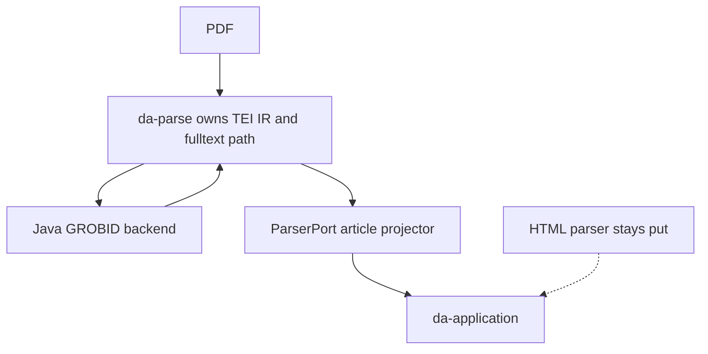
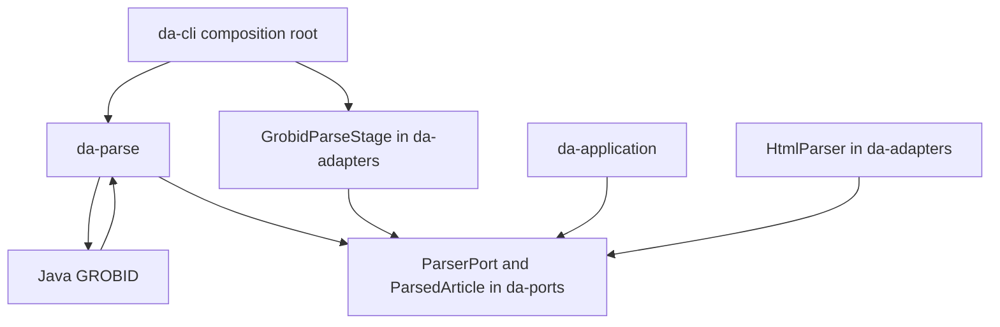
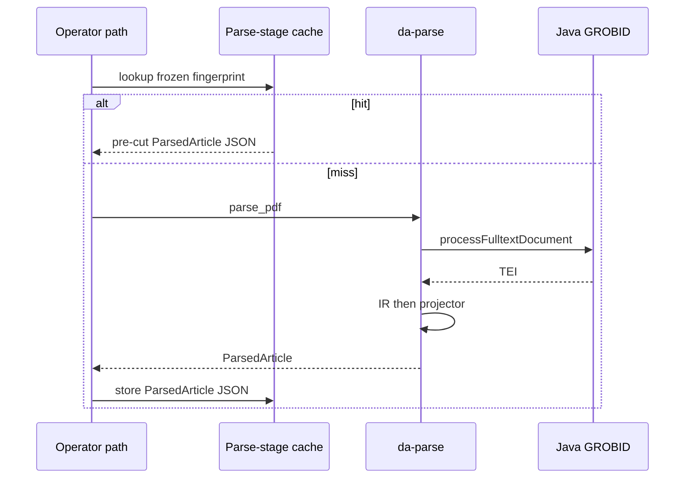

# da-parse Crate Ownership - Plan

## Goal Capsule

- **Objective:** Parse-plane maintainers have a workspace crate that owns scholarly PDF fulltext parse, so later conservation and native stages have a home that is not the graph and infra crate. Pipeline operators still receive the same parse-port article. Ingest and graph behavior do not change.
- **Means:** Extract existing PDF fulltext parse into `da-parse` as an ownership slice: Java GROBID HTTP as an in-crate backend plus the current TEI lift, leaving HTML, pdf-classifier, and XY-Cut where they are. (ownership-slice Key Decision; KTD5)
- **Product authority:** This plan owns crate extraction only. Conservation inventory, P0 TEI tissue lift, layout bake-off, specialist cascade, GROBID-compatible REST, and parse-stage cache split are not active scope.
- **Open blockers:** None.
- **Execution profile:** In-repo workspace crate. Per-crate `cargo` checks. Hexagonal governor must still pass.
- **Stop conditions:** Stop when the pipeline PDF path runs through `da-parse` under `ParserPort`, hexagonal gates still pass, and unchanged PDFs with the same GROBID profile reuse the pre-cut parse-stage payload without calling Java GROBID. Do not continue into P0 lift or native heads in this work unit.
- **Tail ownership:** Parse-plane maintainer of daily-archive.

---

## Product Contract

### Summary

Extract PDF fulltext parse from adapters into workspace crate `da-parse`: Java GROBID HTTP plus current TEI lift, with a distinct IR and the pipeline article as projector.
HTML, classifier, and XY-Cut stay put.
Java remains the fulltext engine until a later native stage passes conservation.

### Problem Frame

PDF and TEI parse today live in the adapters crate beside the graph store.
The pipeline article lifts tables and formulas with typed missingness, but TEI tissue such as authors and non-table figures never reaches that article, so extraction F1 can stay green while structure is silently dropped.
There is no crate boundary for conservation, GROBID-shaped control, or native cascade heads without growing the same infra crate.

### Key Decisions

- **Ownership slice, not relocate-all.** First cut is the home plus the PDF fulltext path. Governs R9, R10. (session-settled: user-approved — chosen over moving HTML, pdf-classifier, and XY-Cut in the same unit: the crate should exist before later residents move)
- **Not a sidecar facade.** Governs R3, R14. (session-settled: user-directed — chosen over leaving HTTP GROBID forever in adapters: the parse crate must own the backend)
- **No graph store in the parse crate.** Governs R4, R8. (session-settled: user-directed — chosen over `kg-parse` or parse remaining beside Samyama: sidecar TEI is not graph truth)
- **Slice the move.** Governs R9. (session-settled: user-directed — chosen over dumping HTTP plus lossy lift as one blob)
- **Parse port stays the application contract.** Governs R2, R7. (session-settled: user-directed — chosen over a publishable kit that does not implement the port)
- **TEI IR with the pipeline article as a projector.** Governs R5, R6. (session-settled: user-approved — chosen over treating the pipeline article as the crate's only public type: later lift needs a home without this unit doing the lift)
- **Java remains the fulltext engine in this cut.** Governs R11. (session-settled: user-directed — chosen over removing Java or 404ing deferred GROBID-shaped behavior here)
- **`da-parse`, not `kg-parse`.** Governs R1, R4. (session-settled: user-directed — chosen over a universal `kg-*` parse crate: `kg-*` must not depend on `da-*`, and parse is product-plane)



<!-- ce-section: work-relationships -->
### How This Work Fits Together

This plan owns extracting `da-parse` as the parse-plane home.
The surrounding six-idea map is the current understanding, not a committed roadmap.

- Conservation inventory as a public gate
  - Depends on this crate as the home for the function
  - Can proceed independently of HTML and classifier moves
- P0 TEI tissue lift for authors, idno, and non-table figures
  - Depends on this crate owning TEI IR
  - Shares silent-loss rules with the article projector
- Layout token versus Rust extractor bake-off
  - Can proceed independently once the crate exists
- GROBID-shaped specialists and per-head learning
  - Depends on the crate as cascade home
- GROBID-compatible HTTP API as crate control
  - Depends on the crate owning the fulltext path
  - Shares Java-holds-the-contract-until-conservation
- Parse-stage cache split
  - Shares pipeline stage wiring
  - Still to decide whether the stage executor moves with the parser

### Actors

- A1. Parse-plane maintainer. Owns `da-parse` and later parse-plane work.
- A2. Pipeline operator. Runs ingest and materialize; notices if PDF parse breaks.
- A3. Application. Consumes `ParserPort` only.
- A4. Java GROBID sidecar. Fulltext engine behind the crate until a later native stage.

### Key Flows

- F1. PDF fulltext parse through the new crate
  - **Trigger:** A pipeline or operator requests parse of a PDF.
  - **Actors:** A2, A3, A4
  - **Steps:** The composition root constructs the `da-parse` parser. The application calls `ParserPort`. On a parse-stage cache hit (R13), the stored payload is reused and Java GROBID is not called. Otherwise the crate calls Java GROBID, records TEI into crate-owned IR, and projects the pipeline article including R087 missingness for tables and formulas.
  - **Outcome:** The application receives the current article contract. Ingest and graph are unchanged.
  - **Covered by:** R2, R3, R5, R6, R7, R11, R13

### Requirements

**Ownership**

- R1. A workspace crate named `da-parse` owns scholarly PDF fulltext parse for daily-archive.
- R2. `da-parse` implements `ParserPort` so the application keeps talking the existing parse port.
- R3. Java GROBID HTTP is a backend inside `da-parse`, not an adapters-only sidecar facade.
- R4. Production dependencies of `da-parse` do not include Samyama or `kg-*` crates.
- R5. The crate owns a TEI-shaped parse IR. The pipeline article is one projector of that IR, not the IR itself. This-cut IR holds raw TEI plus tissues already present on today's article. It does not parse authors, article-level idno, or non-table figures into IR fields.

**Compatibility**

- R6. The first article projector keeps the current article fields, including R087 missingness for tables and formulas.
- R7. `da-application` production dependencies do not include `da-parse`. The composition root constructs the parser.
- R8. Graph import stays locked. Sidecar TEI is not graph truth.
- R9. Existing PDF fulltext behavior moves in slices, not as one dump of HTTP plus lossy lift. Slices are internal to this cut: a tree where `da-parse` owns HTTP while adapters still own TEI lift is not shippable. The cut ships only when the HTTP backend, TEI IR, and article projector all live in `da-parse`.
- R10. The first cut does not require moving the HTML parser, pdf-classifier, or XY-Cut types.
- R13. This cut preserves parse-stage cache hits for unchanged PDFs. A hit means an unchanged PDF with the same GROBID profile reuses the pre-cut stored parse-stage payload and does not call Java GROBID. Parse-stage cache split remains deferred.

**Bounds**

- R11. Java continues to serve fulltext until a later native stage passes conservation. This cut does not remove Java.
- R12. Hexagonal dependency direction still holds: `da-parse` may depend on `da-ports`; `da-domain` and `kg-*` do not depend on `da-parse`.
- R14. Production GROBID HTTP, TEI lift, and the tests that lock PDF fulltext article semantics live in `da-parse`. `da-adapters` may keep a `ParserPort` stage wrapper. It must not grow a second HTTP client.

### Acceptance Examples

- AE1. Pipeline PDF parse keeps the article contract
  - **Covers R2, R6.**
  - **Given:** A PDF that today's GROBID fulltext path can parse.
  - **When:** The application calls `parse_pdf` on the `da-parse` implementation.
  - **Then:** The article still carries title, abstract, body, sections, citations, `tei_xml`, tables, formulas, and R087 missingness with the same semantics as today.
- AE2. Parse crate stays off the graph store
  - **Covers R4.**
  - **Given:** `da-parse` is a workspace member.
  - **When:** Production dependencies are inspected.
  - **Then:** They do not include Samyama or `kg-*`.
- AE3. HTML parse is not part of this cut
  - **Covers R10.**
  - **Given:** An HTML textbook path that today's HTML parser supports.
  - **When:** This crate cut ships.
  - **Then:** HTML parse still works from its current home. It is not required to live in `da-parse`.
- AE4. Application stays hexagonal
  - **Covers R7.**
  - **Given:** Production manifests after the crate exists.
  - **When:** `da-application` dependencies are inspected.
  - **Then:** They do not include `da-parse` or `da-adapters`.
- AE5. This cut does not open graph import
  - **Covers R8.**
  - **When:** `da-parse` ships.
  - **Then:** `import_eligible` remains false. TEI from the crate is not treated as graph truth.
- AE6. This cut does not perform P0 tissue lift
  - **Covers R6.**
  - **Given:** TEI that contains authors or non-table figures.
  - **When:** The first article projector runs.
  - **Then:** The pipeline article still has no author-list, article-level idno, or non-table figure index. Those fields remain later-lift work.
- AE7. Domain and kg crates stay off the parse crate
  - **Covers R12.**
  - **Given:** Production manifests after the crate exists.
  - **When:** `da-domain` and each `kg-*` workspace member are inspected.
  - **Then:** None list `da-parse` as a dependency. `da-parse` may list `da-ports`.
- AE8. Unchanged PDFs keep parse-stage cache hits
  - **Covers R13.**
  - **Given:** A PDF whose pre-cut parse-stage payload is already stored, and the GROBID profile is unchanged.
  - **When:** A path that already uses parse-stage cache (load, journey, materialize lookup, or orchestrated `grobid_parse`) requests parse of that PDF.
  - **Then:** The pre-cut payload is reused. Java GROBID is not called.
- AE9. This-cut IR does not parse P0 tissues
  - **Covers R5.**
  - **Given:** TEI that contains authors or non-table figures.
  - **When:** This-cut IR is built.
  - **Then:** IR holds raw TEI plus tissues already on today's article. It has no author-list, article-level idno, or non-table figure index.

### Success Criteria

- `da-parse` is a workspace member and is the implementation behind PDF `ParserPort` at the composition root.
- Production GROBID HTTP, TEI lift, and tests that lock PDF fulltext article semantics live in `da-parse`, per R14.
- Unchanged PDFs still hit the parse-stage cache, per R13.
- Governor hexagonal checks still pass.
- Per-crate tests for the PDF parse path still pass.
- Pipeline PDF parse still yields the article contract in AE1. Extraction micro-F1 is not a success signal for this cut.

### Scope Boundaries

**Deferred for later**

- Conservation inventory as a public API or CI gate
- P0 lift of authors, idno, and non-table figures into the article projector
- Layout-token bake-off and native cascade heads
- GROBID-compatible REST surface
- Parse-stage cache split
- Moving HTML parse, pdf-classifier, or XY-Cut into `da-parse`
- Publishing `da-parse` to crates.io

**Outside this product's identity**

- A universal `kg-parse` crate
- An ingest, graph, or extract umbrella crate
- GROBID JNI as the product
- Treating sidecar TEI as graph truth
- Opening graph import without an explicit human go

### Deferred to Follow-Up Work

- Dead `da-graph` package IDs in CI fmt lists. Add `da-parse` to live lists. Do not use the dead fmt list as the template.
- Rename or enable skipped real-TEI fixtures whose on-disk directory does not match the test join path.
- An httpmock suite for GROBID down, timeout, and non-2xx. This cut preserves today's unmocked HTTP behavior.
- Removing the adapters re-export after the compatibility window.
- Adding parse-stage cache to uncached `da ingest` / scheduler ingest.

### Dependencies / Assumptions

- Java GROBID sidecar remains required for fulltext in this cut.
- `ParserPort` and the pipeline article type remain the application-facing contract. Physical module location of that type is planning's job.
- `doc/adr` has no accepted ADR-075. STRATEGY.md cites ADR-065/075 as direction only. This cut does not wait on ADR-075.
- Working crate name is `da-parse` as chosen in ideation.

### Outstanding Questions

**Resolve Before Planning**

- None.

**Deferred to implementation**

- Exact module file names inside `da-parse` (KTD9 names seams, not filenames).
- Whether the compatibility re-export is `pub use` or a type alias.

### Sources / Research

- `.compound-engineering/STRATEGY.md` — parse and materialization plane; D127; TEI is not graph truth
- `Cargo.toml` — no `da-parse` member today
- `crates/da-ports/src/parser.rs` — `ParsedArticle`, `ParserPort`, R087 table/formula missingness
- `crates/da-adapters/src/grobid_parser.rs` — HTTP GROBID plus current lift; implements `ParserPort`
- `crates/da-adapters/src/html_parser.rs` — HTML `ParserPort`; out of this cut
- `crates/da-adapters/src/pipeline_stages.rs` — `GrobidParseStage` holds `ParserPort`
- `crates/da-adapters/Cargo.toml` — adapters production depends on Samyama
- `crates/da-domain/src/tei_figures.rs` — `TeiFigure` exists off the pipeline article
- `crates/da-domain/src/xy_cut.rs` — `LineBox`; out of this cut
- `scripts/verify_rust_architecture.sh` — application must not depend on adapters; crate lists omit `da-parse`
- `doc/research/m463-grobid-parse-plane.md` — proposed ADR-075 / `da-parse`; not an accepted ADR
- `.compound-engineering/artifacts/ideation/2026-08-26-pure-rust-scholarly-parse-crate-ideation.html` — ranked ideas and settled parse-plane direction

---

## Planning Contract

### Product Contract preservation

R1–R14 and AE1–AE8 keep their IDs and meaning.
R5 gained the this-cut IR bound confirmed at planning (raw TEI plus already-lifted tissues; no P0 fields).
AE8 `When` now names paths that already cache, not uncached ingest.
AE9 was added to lock that IR bound.
Former deferred-to-planning questions are answered as KTD1–KTD7.

### Key Technical Decisions

- KTD1. **This-cut IR is raw TEI plus already-lifted tissues.** A distinct type, not `ParsedArticle` renamed. It stores the TEI string and the tissues already on today's article (title, abstract, body, sections, citations, tables, formulas, R087 missingness, `pdf_hash`). It does not parse authors, article-level idno, or non-table figures. The projector is a pure function from that IR to `ParsedArticle`. Cache payload stays pre-cut `ParsedArticle` JSON. Instantiates R5. (session-settled: user-approved — chosen over typed author/idno/figure slots this cut: P0 lift stays a later unit)
- KTD2. **Parse-stage fingerprint strings stay byte-identical.** Both live identities remain: load/journey/materialize (`stage_id=parse`, `da_adapters::GrobidParser@load-v1`, `ParsedArticle.v1`) and orchestrated production (`stage_id=grobid_parse`, `GrobidParser@tei-navigation-v3`, `ParsedArticle@serde-v3-unique-navigation`). Profile fingerprints and the legacy `pdf-grobid` lookup stay. Do not rename the load key to `da_parse::…`. Instantiates R13. (session-settled: user-approved — chosen over renaming keys to `da-parse`: stored payloads would cold-start)
- KTD3. **R13/AE8 cover existing cache paths only.** Load, journey, materialize lookup, and orchestrated `grobid_parse` keep hits. Uncached `da ingest` and scheduler ingest still call Java every time, as today. Instantiates R13. (session-settled: user-approved — chosen over adding ingest cache this cut: that is extra product scope)
- KTD4. **`ParsedArticle` stays in `da-ports`.** `da-parse` implements `ParserPort` and depends on `da-ports`. Moving the article type into `da-parse` would invert ports onto parse. Instantiates R2, R12.
- KTD5. **`GrobidParseStage` stays in adapters; one-window re-export of parser types.** The stage keeps `Arc<dyn ParserPort>` and must not grow a GROBID HTTP client. After HTTP and lift leave adapters, `da-adapters` may `pub use` `GrobidParser` / `GrobidProfile` for one compatibility window. Composition roots may construct via that re-export or via `da-parse` directly. `da-cli` should take a workspace `da-parse` dependency. Instantiates R3, R7, R14. (session-settled: user-approved — chosen over moving the stage with the crate, or a flag-day of every construction site)
- KTD6. **R4 is this crate's direct `[dependencies]`.** `da-parse` may depend on `da-ports` even though `da-ports` already lists `kg-*`. Do not split `ParserPort` out of `da-ports` in this cut. Inspect `crates/da-parse/Cargo.toml`, not `cargo tree`. Instantiates R4, R12.
- KTD7. **Preserve today's GROBID-down, timeout, and empty-TEI behavior.** Load preflight versus journey retry-suppression stay as they are. HTTP 200 with empty TEI still succeeds and may be cached. Do not add an httpmock HTTP suite as a ship gate. Instantiates R6 compatibility.
- KTD8. **Onion and CI lists must name `da-parse`, including `cargo test -p da-parse --lib`.** Today's architecture gate runs `da-adapters --tests`, which does not run `grobid_parser.rs` unit tests. After the move those article locks are off CI unless `da-parse --lib` is added. Also extend kg `da-*` regexes, add `da-application` must not depend on `da-parse`, and add `da-parse` to fmt/clippy/pre-commit/governor live lists. Instantiates R7, R12, R14.
- KTD9. **Split `grobid_parser` along existing private-method seams.** Copy the `kg-ontology` lib-crate shape (`lib.rs` module list plus `pub use`), not `da-mcp`. Seams: profile, HTTP client, TEI IR, lift (title/body, sections, citations, tables, formulas), projector. Do not dump the 3.5k-line file as one blob internally. Instantiates R9.

### High-Level Technical Design

After the cut, adapters keep graph/HTML/stage wiring.
`da-parse` owns HTTP, IR, and the article projector.
Application still talks only ports.



Cache hit never builds IR and never calls Java.
Miss path: HTTP TEI → IR → projector → `ParsedArticle` JSON stored as today.



### Output Structure

```text
crates/da-parse/
  Cargo.toml
  src/
    lib.rs
    profile.rs      # GrobidProfile, TEI_COORDINATES, fingerprints
    http.rs         # client, is_alive, process_fulltext
    ir.rs           # this-cut TEI IR
    lift/           # extractors along existing seams
    projector.rs    # ParserPort parse_pdf
```

Filenames are directional (KTD9). Implementer may regroup lift modules.

### Sequencing

U1 then U2 then U3 then U4 then U5.
U2 and U3 may exist on the feature branch while adapters still hold the old file.
The cut is not shippable until U4 deletes adapters HTTP and the projector lives in `da-parse` (R9).

### Deferred implementation notes

- Exact helper names after the split.
- Whether `is_alive` stays a concrete method on `GrobidParser` (it is not on `ParserPort` today).
- Whether adapters drop unused parse-only deps. `reqwest` stays in adapters for `http_fetch`.
- GitNexus reindex after the crate exists (`node .gitnexus/run.cjs analyze`). Index is already stale for this path.

### Alternative Approaches Considered

- **Relocate-all in one cut** (HTML, classifier, XY-Cut with PDF). Rejected at product: ownership slice first.
- **Sidecar facade** (HTTP stays in adapters; `da-parse` only re-exports). Rejected at product: crate must own the backend.
- **Split `ParserPort` out of `da-ports`** to avoid transitive `kg-*` under R4. Rejected: re-litigates port location; KTD6 reads R4 as direct deps.
- **Rename load fingerprint to `da_parse::…`.** Rejected at planning: cold-starts operator cache (KTD2).
- **Dump `grobid_parser.rs` as one file in the new crate.** Rejected: contradicts slice-the-move; KTD9 splits along existing seams, still one shippable tree with U4.

### Research breadcrumbs

- Cache identities: `crates/da-cli/src/load.rs` `parse_cache_key`; `crates/da-cli/src/load_journey.rs` `load_parse_contract`; `crates/da-cli/src/production.rs` `GrobidParser@tei-navigation-v3`; pin in `crates/da-cli/tests/load_journey_test.rs`.
- Profile fingerprint tests live in `crates/da-adapters/src/grobid_parser.rs` `mod tests` / `mod real_tei_tests`.
- Gate lists: `scripts/verify_rust_architecture.sh`, `scripts/governor/__main__.py` `_run_architecture_gate`, `scripts/governor/adapters/clippy_scanner.py` `OUR_CRATES`, `scripts/governor/checks/adr_rules.yaml` `kg_crates_must_not_depend_on_da`, `.pre-commit-config.yaml`, `.github/workflows/architecture-guardrail.yml`.
- Construction sites: `da-cli` `main.rs`, `load.rs`, `load_journey.rs`, `production.rs`, `source_cli.rs`; examples `eval_batch`, `eval_extract`, `batch_promote_gold`, `gepa_hub_research`, `catalog_sweep_runner`, `gold_corpus_canary`, `figure_context`, `pipeline_figures`.
- Institutional solutions corpus is empty. No prior parse-crate learning to reuse.

---

## Implementation Units

### U1. Workspace crate and onion gates

- **Goal:** `da-parse` exists as a workspace lib crate, compiles empty-or-stub, and hexagonal/CI lists treat it as a first-class `da-*` member so later units cannot slip past gates.
- **Requirements:** R1, R4, R7, R12; AE2, AE4, AE7; KTD6, KTD8
- **Dependencies:** none
- **Files:**
  - `crates/da-parse/Cargo.toml` (create)
  - `crates/da-parse/src/lib.rs` (create)
  - `Cargo.toml`
  - `scripts/verify_rust_architecture.sh`
  - `scripts/governor/__main__.py`
  - `scripts/governor/adapters/clippy_scanner.py`
  - `scripts/governor/checks/adr_rules.yaml`
  - `scripts/tests/test_governor.py`
  - `.pre-commit-config.yaml`
  - `.github/workflows/architecture-guardrail.yml`
- **Approach:**
  1. Add a lib crate with workspace edition/version and a workspace.dependencies entry (follow `da-adapters`, not path-only `da-mcp`).
  2. Prod deps at this unit: none required beyond what a stub needs. Do not add Samyama or `kg-*` (KTD6).
  3. Extend live fmt/clippy/test package lists with `da-parse`. Add `cargo test -p da-parse --lib` to the architecture gate (KTD8).
  4. Extend kg `da-*` regexes to include `da-parse` (and keep existing members). Add `da-application` must not list `da-parse` in prod deps, matching the adapters rule.
  5. Add `da-parse` to CI live clippy/test blocks. Do not copy the dead `da-graph` fmt list as the template.
- **Execution note:** This is scaffolding plus gate wiring. Do not move parse code here.
- **Patterns to follow:** `crates/kg-ontology/Cargo.toml` for lib-crate workspace metadata; `da_application_must_not_depend_on_da_adapters` for the new application rule.
- **Test scenarios:**
  - Happy path: `da-parse` is a workspace member and `cargo check -p da-parse` succeeds.
  - Covers AE2. Direct `[dependencies]` of `da-parse` do not list `samyama` or `kg-*`.
  - Covers AE4. `da-application` prod deps do not list `da-parse`.
  - Covers AE7. `da-domain` and each `kg-*` Cargo.toml do not list `da-parse`.
  - Edge: injecting `da-parse` into a `kg-*` prod dep fails the kg gate (same shape as the existing `da-domain` injection test).
  - Error: injecting `da-parse` into `da-application` prod deps fails the new hexagonal check.
- **Verification:** Architecture preflight lists `da-parse`. A stub crate cannot depend on Samyama. Application cannot take a prod dep on `da-parse`.

### U2. Profile and HTTP backend in da-parse

- **Goal:** `da-parse` owns `GrobidProfile` and the Java GROBID HTTP client with byte-identical configuration fingerprints.
- **Requirements:** R3, R11, R13; KTD2
- **Dependencies:** U1
- **Files:**
  - `crates/da-parse/src/lib.rs`
  - `crates/da-parse/src/profile.rs` (or equivalent seam)
  - `crates/da-parse/src/http.rs` (or equivalent seam)
  - `crates/da-parse/Cargo.toml` (add `da-ports`, `async-trait`, `reqwest`, `tokio`, `tracing`, and other deps the HTTP client already uses)
  - `crates/da-adapters/src/grobid_parser.rs` (leave in place until U4)
- **Approach:**
  1. Move profile and HTTP along KTD9 seams. Keep `configuration_fingerprint()` strings, `TEI_COORDINATES`, and REST `teiCoordinates` JSON identical.
  2. Timeout stays operational and out of the fingerprint.
  3. `DEFAULT_GROBID_URL` stays `http://127.0.0.1:8070` (governor allows that host).
  4. Do not delete adapters HTTP in this unit (R9 / Sequencing).
- **Execution note:** Not shippable until U4. Prefer moving the existing profile fingerprint tests with the type rather than rewriting them.
- **Patterns to follow:** Current `GrobidProfile` / `process_fulltext` / `is_alive` in `crates/da-adapters/src/grobid_parser.rs`.
- **Test scenarios:**
  - Happy path: rich and structural `configuration_fingerprint()` match today's locked strings, including `formula` in coordinates.
  - Edge: two parsers that differ only in timeout still share a fingerprint.
  - Edge: default `GrobidParseStage` compact fingerprint (no `profile=`) is not "fixed" to match `GrobidProfile` unless analysis shows nothing hashes the default.
  - Error: HTTP client still maps non-2xx to parse failure and transport failure to unavailable, same as today (KTD7). Behavior may stay covered by existing unmocked tests; do not block on new httpmock.
- **Verification:** Profile fingerprint tests pass in `da-parse`. No Samyama/`kg-*` crept into prod deps while adding HTTP crates.

### U3. TEI IR, lift, projector, and article-lock tests

- **Goal:** `da-parse` owns this-cut IR, current TEI lift, `ParserPort` projector, and the tests that lock PDF fulltext article semantics.
- **Requirements:** R2, R5, R6, R9, R14; AE1, AE6, AE9; KTD1, KTD4, KTD9
- **Dependencies:** U2
- **Files:**
  - `crates/da-parse/src/ir.rs` (or equivalent)
  - `crates/da-parse/src/lift/` (or equivalent modules)
  - `crates/da-parse/src/projector.rs` (or equivalent)
  - `crates/da-parse/src/lib.rs`
  - tests that today live in `crates/da-adapters/src/grobid_parser.rs` (`mod tests`, `mod real_tei_tests`)
- **Approach:**
  1. Introduce a distinct IR type per KTD1. Do not add author/idno/non-table-figure fields.
  2. Move extractors along existing private-method seams. Projector builds `ParsedArticle` with the same fields and serde names as today, including `#[serde(default)]` tables/formulas/missingness.
  3. `layout_json` stays `None` on the GROBID path. `page_text_missingness` stays `None` here (classifier stamps later).
  4. Move article-lock tests with the lift. Do not "fix" the skipped real-TEI fixture directory in this cut.
  5. Do not change `ParsedArticle` in `da-ports` except if a compile break proves a missed re-export; prefer zero change (KTD4).
- **Execution note:** Characterization first: existing ParserPort/TEI tests move before any intentional lift change. Not shippable until U4.
- **Patterns to follow:** Current `extract_*` family and `impl ParserPort for GrobidParser::parse_pdf` in `grobid_parser.rs`.
- **Test scenarios:**
  - Covers AE1. Fixture TEI that today's lift parses still yields title, abstract, body, sections, citations, `tei_xml`, tables, formulas, and R087 missingness with the same semantics.
  - Covers AE6. TEI containing authors or non-table figures still projects an article with no author-list, article-level idno, or non-table figure index.
  - Covers AE9. The IR type has no author-list, article-level idno, or non-table figure index (compile-level absence or explicit unparsed).
  - Happy path: nested section `path_id` tests still pass.
  - Edge: table/formula missingness tests still distinguish empty vs not-extracted.
  - Edge: skipped real-TEI tests remain skipped unless the files already exist at the joined path. Do not rename `data/corpora` vs `data/article_corpora` here.
  - Error: empty TEI still returns success with empty fields and `tei_xml` present (KTD7).
- **Verification:** `cargo test -p da-parse --lib` is the home of PDF article locks. Projector output matches today's article contract.

### U4. Cut over composition roots and strip adapters HTTP

- **Goal:** Production PDF parse is constructed from `da-parse`. Adapters keep `GrobidParseStage` and HTML. Adapters HTTP/lift source is gone. One-window re-export may remain. Cache fingerprint strings are unchanged.
- **Requirements:** R3, R7, R9, R10, R13, R14; AE3, AE8; KTD2, KTD3, KTD5
- **Dependencies:** U3
- **Files:**
  - `crates/da-adapters/src/grobid_parser.rs` (remove HTTP/lift or replace with re-export)
  - `crates/da-adapters/src/lib.rs`
  - `crates/da-adapters/src/pipeline_stages.rs`
  - `crates/da-adapters/src/html_parser.rs` (do not move; comments may still mention GROBID by name)
  - `crates/da-adapters/Cargo.toml`
  - `crates/da-cli/Cargo.toml`
  - `crates/da-cli/src/main.rs`
  - `crates/da-cli/src/load.rs`
  - `crates/da-cli/src/load_journey.rs`
  - `crates/da-cli/src/production.rs`
  - `crates/da-cli/src/source_cli.rs`
  - `crates/da-cli/tests/load_journey_test.rs`
  - `crates/da-cli/examples/eval_batch.rs`
  - `crates/da-cli/examples/eval_extract.rs`
  - `crates/da-cli/examples/batch_promote_gold.rs`
  - `crates/da-cli/examples/gepa_hub_research.rs`
  - `crates/da-cli/examples/catalog_sweep_runner.rs`
  - `crates/da-cli/examples/gold_corpus_canary.rs`
  - `crates/da-cli/examples/figure_context.rs`
  - `crates/da-cli/examples/pipeline_figures.rs`
- **Approach:**
  1. Point composition roots at `da-parse` (or the adapters re-export). `da-cli` lists `da-parse` as a workspace prod dep. `da-application` does not.
  2. Delete adapters GROBID HTTP client. Keep `GrobidParseStage` as `ParserPort` wrapper (KTD5).
  3. Optional `pub use` of `GrobidParser` / `GrobidProfile` from adapters for one window.
  4. Leave fingerprint string literals in `load.rs` / `load_journey.rs` / `production.rs` byte-identical (KTD2), including `da_adapters::GrobidParser@load-v1`.
  5. Leave HTML parser, pdf-classifier, and XY-Cut in place (R10).
- **Execution note:** This unit makes the cut shippable. Prove cache keys with existing load-journey and profile-binding tests before considering the unit done.
- **Patterns to follow:** `GrobidParseStage` already takes `Arc<dyn ParserPort>`. HtmlParseStage stays beside it.
- **Test scenarios:**
  - Covers AE3. HTML parse still constructs `HtmlParser` from adapters and is not required to live in `da-parse`.
  - Covers AE8. Load/journey tests still assert `da_adapters::GrobidParser@load-v1` and reuse stored payloads without renaming the key.
  - Happy path: production `grobid_parse` identity remains `GrobidParser@tei-navigation-v3` plus `ParsedArticle@serde-v3-unique-navigation`.
  - Happy path: `da-cli` examples that constructed `GrobidParser` still compile (`pdf-classifier` feature matrix included).
  - Edge: legacy load lookup `configuration_fingerprint = "pdf-grobid"` still exists for rich PDF-only.
  - Integration: adapters have no second GROBID HTTP client (no leftover `processFulltextDocument` POST in adapters).
  - Error: `da-application` prod deps still omit `da-parse` and `da-adapters`.
- **Verification:** PDF construction sites compile against `da-parse`. Adapters do not own GROBID HTTP. Existing cache-key tests stay green. HTML path unchanged.

### U5. Package maps

- **Goal:** Human package maps say `da-parse` owns PDF fulltext parse, so later parse-plane work does not land back in adapters by habit.
- **Requirements:** R1
- **Dependencies:** U4
- **Files:**
  - `AGENTS.md`
  - `README.md`
  - `crates/OKF.md`
  - `scripts/governor/checks/dimensions.yaml` (hexagonal evidence line that names adapters as the only port-impl crate)
- **Approach:**
  1. Add `da-parse` to the package map as PDF/TEI fulltext parse. Keep adapters as Samyama, HTML, classifier, other port impls.
  2. Update `scripts/governor/checks/dimensions.yaml` hexagonal evidence so it names `da-parse` as the PDF `ParserPort` impl crate and `da-adapters` as the remaining port impls (HTML, stages, Samyama). Remove wording that adapters are the only port-impl crate.
  3. Do not accept ADR-075. Do not treat `doc/research/m463-grobid-parse-plane.md` as binding.
  4. Reindex GitNexus after the crate exists if the operator runs that locally. Not a ship gate.
- **Test expectation:** none -- documentation and map text only.
- **Verification:** Package maps name `da-parse` for PDF fulltext. Adapters description no longer claims sole GROBID ownership.

---

## Verification Contract

Per-crate only. Do not run `cargo test --workspace` or `cargo check --workspace` (RocksDB rebuild trap).

| Gate | When | Command | Proves |
|---|---|---|---|
| Parse crate check | After U1+ | `cargo check -p da-parse` | Crate exists |
| Parse clippy | After U2+ | `cargo clippy -p da-parse --all-targets --no-deps -- -D warnings` | Adapter-like crate is warning-clean |
| Article locks | After U3 | `cargo test -p da-parse --lib` | AE1, AE6, AE9, R14 tests moved |
| Adapters leftover | After U4 | `cargo test -p da-adapters --lib` and `cargo test -p da-adapters --tests` | HTML/stage still pass; GROBID file gone |
| Cache keys | After U4 | `cargo test -p da-cli --lib parse_cache_keys_bind_grobid_profile_semantics` and `cargo test -p da-cli --test load_journey_test` | AE8, KTD2 |
| CLI wiring | After U4 | `cargo check -p da-cli --features pdf-classifier --examples` | Construction sites compile |
| Onion | After U1, again after U4 | `PYTHONPATH=scripts python3 -m governor --phase preflight --check-only` | AE2, AE4, AE7, KTD8 |
| Full architecture | Slice end only | `PYTHONPATH=scripts python3 -m governor architecture` | Fmt, clippy, hexagonal, per-crate tests including `da-parse --lib` |

`eval_batch` / extraction micro-F1 is not a success signal for this cut.

---

## Definition of Done

**Global**

- Pipeline PDF parse goes through `da-parse` under `ParserPort` at the composition root.
- HTTP backend, TEI IR, article projector, and PDF article-lock tests live in `da-parse` (R9, R14).
- Adapters have no GROBID HTTP client. `GrobidParseStage` and HTML remain (R10, R14, KTD5).
- Direct prod deps of `da-parse` exclude Samyama and `kg-*` (R4, KTD6).
- `da-application`, `da-domain`, and `kg-*` do not depend on `da-parse` (R7, R12).
- Load/journey and orchestrated `grobid_parse` fingerprint strings are unchanged (R13, KTD2). Uncached ingest still calls Java (KTD3).
- `import_eligible` remains false (R8).
- Governor architecture passes with `da-parse` on live lists and `cargo test -p da-parse --lib` in the gate (KTD8).
- Abandoned-attempt code from unused module layouts is removed from the diff.

**Per unit**

- U1. Workspace member + gate lists + dependency bans.
- U2. Profile fingerprints byte-identical; HTTP client in `da-parse`.
- U3. IR per KTD1; projector matches AE1/AE6; tests in `da-parse --lib`.
- U4. Cutover complete; adapters HTTP gone; cache-key tests green.
- U5. Package maps updated.

---

## System-Wide Impact

- **Hexagonal gates:** a second infrastructure crate that implements a port. Today's application→adapters check does not see `da-parse` until U1.
- **Parse-stage cache:** two dialects. Identity is string equality, not crate path.
- **Composition roots:** CLI, journey, production, source CLI, and eval/sweep examples construct the parser.
- **Logging:** `da-parse` may use `tracing` (adapter-like). `da-ports` / `da-domain` / `kg-*` stay tracing-free.
- **Import / graph:** no change. TEI is still not graph truth.

---

## Risk Analysis

| Risk | Why | Mitigation |
|---|---|---|
| Renaming `da_adapters::GrobidParser@load-v1` | Looks like a cleanup after the move | KTD2; existing load-journey pin; U4 test scenarios |
| Forgetting `da-parse --lib` on the architecture gate | Article locks are unit tests, not `--tests` | KTD8; U1 adds the command |
| Shipping U2 without U4 | HTTP in two crates, lift still in adapters | Sequencing + R9; cut ships at U4 |
| Reading R4 via `cargo tree` | Transitive `kg-*` through `da-ports` | KTD6; AE2 inspects this crate's Cargo.toml |
| Dual cache dialects | Easy to freeze one and miss the other | KTD2 names both |
| Stale GitNexus | Impact on `GrobidParser` under-reports callers | Grep construction sites listed in U4; reindex after |

---

## Documentation / Operational Notes

U5 updates package maps.
Java GROBID sidecar remains required (`docker compose` grobid / `:8070`).
No new operator runbook: cache hits stay silent, misses still need the sidecar.
Do not open D127 import.
