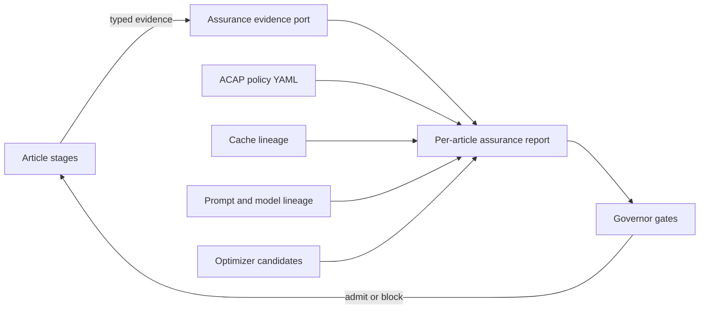

# ADR-055: Article Context Assurance Plane

**Status:** Accepted

**Date:** 2026-08-09

**Related:** ADR-040, ADR-049, ADR-050, ADR-051, ADR-052, ADR-053; D127, D136, D202-D215; R084-R090

## Context

A green stage exit does not prove that scientific context survived the pipeline. An article crosses source acquisition, parsing, document structure, extraction, evidence linking, embedding, graph materialization, external enrichment, identity resolution, summarization, finalization, semantic tasks and checkpoint export. Each boundary can silently drop fields, truncate text, lose lineage, reuse stale cache entries, promote an unvalidated LLM result, or report coverage over a reduced denominator.

M371 found concrete examples: Section text was capped near 10 KB, Paper abstract was not materialized, exact cache output hashes were ambiguous without cache keys, section titles collided without paper-scoped ordinals, and catalog indexes could shadow canonical metadata. Local fixes are necessary but insufficient: the project needs one assurance control plane spanning every article-context layer.

Advanced prompt optimization creates a second risk. DSPy, GRPO, RL and evolutionary search can improve a reward while degrading grounding, ontology validity, held-out behavior, cost or safety. Optimizer output is therefore evidence-bearing candidate data, never an automatically deployed runtime policy.

## Decision

Introduce the **Article Context Assurance Plane (ACAP)** as a cross-cutting control plane adjacent to, not inside, scientific data flow.

- Product stages remain in onion order and emit typed evidence through ports.
- ACAP policy is data in `scripts/governor/checks/article_context_assurance.yaml`.
- Governor validates policy integrity and available assurance reports.
- Canonical truth is lossless. Bounded contexts are derived views with explicit omissions.
- Every missing value has a typed reason: unavailable, not applicable, not attempted, failed, policy blocked or genuinely absent.
- Cache identity binds semantic inputs and output schema; operational retry timing does not invalidate successful semantic content.
- Graph mutation remains outside cacheable stages and must replay to zero writes.
- D127 remains independent and false unless the user explicitly authorizes import.
- Prompt and optimizer artifacts are candidates until schema, grounding, held-out, cost and human gates pass.

## Architecture

ACAP belongs to application policy and infrastructure evidence adapters:

- `da-domain`: metric, state and report value types when runtime implementation begins;
- `da-ports`: assurance evidence/report ports;
- `da-application`: FSM and aggregation use cases;
- adapters/CLI: measurements, durable JSON and operational logs;
- governor: design-time and artifact-time enforcement;
- domain, ports and `kg-*` never own logging/subscriber transport.

## Article Context FSM

The canonical progression is:

`source_registered -> source_verified -> parsed -> structured -> extracted -> evidence_linked -> embedded -> materialized -> enriched -> resolved -> summarized -> finalized -> task_accepted -> accepted_checkpoint`.

Any state may transition to `failed_visible`. A skipped state requires a typed reason. Retry preserves the semantic cache key. A downstream state cannot claim completion when a required predecessor is absent. The FSM records observations; it does not fabricate work for optional layers.

## Layer model and scorecard

Each layer reports:

1. **Hard invariants** - binary admission conditions.
2. **Coverage** - processed eligible units divided by the complete eligible denominator.
3. **Preservation** - required-field, byte and checksum conservation.
4. **Grounding** - authoritative facts linked to evidence paths.
5. **Quality** - independently reviewed stage-specific utility.
6. **Efficiency** - latency p50/p95, cache hit rate, compute/cost per article.
7. **Context efficiency** - selected tokens, utilization, disclosed truncation and grounded information per token.
8. **Replay** - net node/edge/vector writes and output checksum equality.
9. **Missingness** - classified reasons, never denominator erasure.

### Hard metrics

| Metric | Required interpretation |
|---|---|
| required-field retention | 1.0 for available required fields |
| byte conservation | 1.0 for full-fidelity boundaries |
| checksum lineage coverage | 1.0 for durable artifacts |
| typed missingness coverage | 1.0 |
| evidence grounding coverage | 1.0 for authoritative facts |
| ontology conformance | 1.0 |
| cache lineage exactness | 1.0 |
| replay net writes | 0 |
| semantic task pass rate | 1.0 for required tasks |
| D127 unlock count | 0 until explicit authorization |

A weighted score never overrides a failed hard invariant. Aggregate scores are diagnostic and must retain per-layer values and denominators.

### Quality metrics by layer

- source/parse/structure: source readiness, parse success, section/reference/figure coverage, byte conservation; TeX archives additionally require inventory/archive/member checksum binding, deterministic root/include closure, byte-exact candidates, bounded expansion and explicit reject/no-claim reports;
- extraction: micro and macro F1, per-type F1, schema validity, evidence-span hit rate;
- evidence/materialization: evidence-path coverage, nodes/edges/vectors per eligible unit, replay zero;
- embedding/retrieval: valid vector rate, dimension/model lineage, recall@k, temporal/provenance filter correctness;
- enrichment/resolution: source coverage, candidate precision/recall, reviewed decision rate, no self-confirmation;
- summary: schema validity, grounded claim precision/recall, source-span coverage, omission disclosure, faithfulness, context utilization, cost;
- finalize/tasks/checkpoint: invariant pass rate, exact task pass rate, snapshot checksum and reproducible replay.

Quality metrics require independent fixtures or reviewed evidence. The implementation under test cannot construct its own oracle.

## Cache contract

Every cache key binds source checksum, dependency output checksums, implementation and configuration fingerprints and output schema fingerprint. Prompt stages additionally bind prompt ID/version/hash, provider/model, inference configuration and tool/output schema hashes. Lookup requires exact cache key plus exact output checksum. Operational timeout/retry changes are excluded from the semantic key.

Cache records are immutable evidence. Changed vectors or graph facts require an explicit rebuild/upsert path; stale duplication is forbidden.

## Meta and prompt system

Prompts are versioned data, not ad hoc strings embedded in use cases. A prompt registry entry declares:

- stable prompt ID and version;
- template checksum;
- accepted context bundle schema;
- provider/model capabilities;
- inference and tool schema checksums;
- output schema and validator;
- safety, budget and omission policy.

`ContextBundle` records selected units and source spans, token count and budget, truncation flag, and omitted units with reasons. Token admission belongs to the tokenizer-aware backend. Canonical article text is never modified to fit a prompt.

Every prompt run records the complete lineage tuple and validates typed output before any materialization. Raw provider payloads are not logged; durable candidate payloads follow explicit artifact policy.

## Optimizer admission: DSPy, GRPO and related methods

Optimizer families may generate prompt/policy candidates only. No optimizer can auto-promote or write authoritative graph truth.

Admission requires:

- immutable baseline and candidate IDs;
- train/validation checksums and same-N comparison;
- micro F1 and macro F1 non-regression;
- policy-bounded validation gap;
- grounding, schema and semantic-task metrics;
- hard invariant parity;
- contamination check;
- cost and latency deltas;
- reward definition checksum;
- explicit human decision reference.

GRPO additionally requires reward-component breakdown, reward-hacking probes, held-out replay and deterministic tool/action validity. Reward improvement alone is not evidence of semantic improvement. D136 remains binding: the runtime is not enabled until verified metrics and fixtures exist.

## Governor integration

Governor performs three levels:

1. **Policy validation**: unique layer/state/metric IDs, legal FSM transitions, known metrics, prompt/optimizer gate completeness and D127 lock.
2. **Design-time source checks**: information-preservation contracts and onion boundaries.
3. **Artifact/runtime checks**: validate `artifacts/article_context/assurance_report.json` against the policy, reject hard failures, denominator mismatch, illegal FSM transitions, stale policy hash, replay writes, D127 unlocks or unauthorized optimizer promotion.

Rollout is incremental. `bootstrap` layers produce `no_claim` when evidence is absent; `required` layers make absence a high-severity failure. Moving a layer to required is a policy change with tests and evidence.

## ADR-051 verification matrix

- domain: serde roundtrip, metric algebra, FSM property/state-machine tests;
- application: state-based fake aggregation, denominator and hard-gate tests;
- port: evidence sink/report store contract suite;
- adapter: cache/log/report integration and corruption/failure injection;
- system journey: one article and full 200-paper assurance reports;
- metamorphic: stage order violation fails, unchanged replay is zero, adding evidence cannot reduce retained counts;
- mutation: remove hash, truncate text, alter denominator, stale prompt/cache key, auto-promote optimizer - all must fail;
- architecture: governor policy and onion checks.

## Consequences

### Positive

- Pinpoints exactly where context is lost or quality regresses.
- Separates hard correctness from optimization diagnostics.
- Makes cache, prompt, model and optimizer lineage reproducible.
- Supports safe performance and prompt optimization without weakening graph truth.
- Converts incidents into reusable data contracts and mutation tests.

### Negative

- More typed evidence and durable reports increase implementation and storage cost.
- Some quality metrics require reviewed fixtures and cannot be automated cheaply.
- Full-fidelity canonical storage can enlarge snapshots; bounded views must absorb context pressure.

### Neutral

- ACAP does not authorize import, LLM extraction or optimizer deployment.
- Existing graph/task/finalize gates remain; ACAP composes their evidence.

## Alternatives considered

1. **One aggregate quality score** - rejected because averages hide hard failures and denominator loss.
2. **Only static regex checks** - rejected because runtime lineage, FSM and quality need artifacts.
3. **Only runtime telemetry** - rejected because missing reports and source-level lossy mutations can evade telemetry.
4. **Optimizer-managed promotion** - rejected due reward hacking, contamination and D136.

## Implementation sequence

1. Policy and governor validation. **Delivered.**
2. Typed ACAP domain/port/report contracts. **Delivered:** validated content digests,
   FSM/missingness/boundary modes, conservation/count/write observations,
   fail-closed verdict derivation, report-store port, immutable atomic filesystem
   adapter, and a graph-readback materialization checker.
3. Required evidence for source through materialization. **In progress.** The
   checker reads Paper/Section values and scans graph-wide D127 state. Universal
   `kg-storage` mutation instrumentation now records attempted/applied/unchanged/
   rejected outcomes for node/property/edge/vector families and invalidates
   evidence after unobservable query/index/import operations. Missing, empty or
   invalid replay observation is a hard failure. A durable 10-paper real-Samyama
   proof is stored in `artifacts/article_context/materialization_batch_01.json`:
   first applied 9,743; replay attempted 5,113, applied 0, unchanged 5,113,
   rejected 0, unobserved 0; all ACAP verdicts PASS and D127 remains false.
   A deterministic fixed-clock same-process 20-wave/200-paper report is now
   durable at `artifacts/article_context/materialization_all_200.json` with its
   checksum-bound snapshot and all 20 exact hashed inputs under
   `artifacts/article_context/waves/`. It records 23,928 nodes, 39,387 edges,
   200 ACAP PASS,
   D127 false and zero replay writes. The checksum-bound task report at
   `artifacts/article_context/materialization_all_200_tasks.json` records seven
   structural PASS results; Summary, reviewed Resolution and ConceptCluster
   remain explicitly EMPTY and are
   future layers, not hidden inside the materialization verdict. Runtime profiling
   shows the remaining rebuild bottleneck is fine-grained Samyama writes under a
   global lock; parallel immutable preparation is enabled, but unordered graph
   mutation is forbidden pending a typed bulk-write port.
4. Candidate-only TeX source evidence. **Delivered for the `2606.06036` canary.**
   The hardened archive port validates inventory schema and authority, canonical
   archive path, archive/member checksums, unique canonical member names and
   bounded streamed output. Domain analysis selects `main.tex`, resolves 10 files
   through 9 include edges, reads only `references.bib` and emits 30 byte-identity
   candidates. Semantic failure is durably stored as `Reject`; invalid UTF-8,
   incomplete commands and unsupported BibTeX fail rather than under-count.
   Byte-identical replay and D127 false are verified. Provider denominators remain
   conflicting candidates: local 30, Semantic Scholar 24 and OpenAlex 0.
5. Ontology-v2 contract convergence: active endpoint, identity-index, temporal,
   validator, materializer and task-wire projections must share one data-driven
   source before another corpus mutation wave.
6. ACAP contract convergence: Rust per-article and aggregate schemas, physical
   replay partitions, FSM transitions, task classes, policy YAML and governor
   must agree before required-layer claims.

   **M371/S07/T01 (detect-only audit delivered):** A cross-surface
   `AcapContractAuditUseCase` in `da-application` detects eight classes of drift
   between the policy YAML, Rust DTO constants, embedded 200-paper reports, the
   canonical aggregate path and governor expectations. The audit emits
   `artifacts/article_context/acap_contract_audit.json` with a deterministic
   SHA-256 bound to the schema version. Domain `normalize()` was hardened from
   silent identity rewrite to fail-closed rejection of wrong schema/policy
   identity (`SchemaVersionDrift` / `PolicyIdDrift`). A separate aggregate schema
   version (`article-context-assurance-aggregate.v1`) prevents per-article and
   aggregate contract collision. Live canary verdict remains `Drift` with D127
   false; governor product semantics wait for T05.

   **M371/S07/T02 (physical replay reification delivered):** Domain
   `ReplayObservation` / `MutationFamilyObservation` preserve the full mutation
   partition (attempted/applied/unchanged/rejected + unobserved) inside
   `LayerAssuranceResult`. Application maps `kg-storage` `MutationCounters`
   one-to-one; empty instrumentation is `NotRun`, while invalid/unobserved
   partitions are preserved as `Observed` and fail with specific hard codes.
   Serialized reports recompute integrity without in-memory counters.
   `WriteDelta` remains a diagnostic applied/rejected projection only. Legacy v1
   zero-`WriteDelta` reports deserialize and flag
   `replay_observation_integrity:legacy_v1_incomplete` until upgraded from
   paper-level `replay_mutations`. No corpus rebuild and no D127 unlock.

   **M371/S07/T03 (canonical corpus aggregate delivered):** Domain
   `CorpusAssuranceReport` uses distinct aggregate schema version. Application
   `CorpusAssuranceUseCase` composes per-article reports with optional
   `replay_upgrade` from paper-level mutation counters. CLI emits
   `artifacts/article_context/assurance_report.json` from the existing 200-paper
   artifact. Required layers not present stay typed no_claim; aggregate hard
   codes keep corpus Fail until those layers exist. Governor accepts list-typed
   empty hard_failures without inventing product truth.

   **M371/S07/T04 (typed graph-task classes delivered):** Domain
   `GraphTaskClass` / `ClassifiedTaskEvidence` prevent structural and semantic
   suite evidence from collapsing into one boolean. Task DSL `// @class` is
   optional (legacy default structural). Finalize policy may list
   `required_task_classes`; empty preserves overall-boolean gate only.

   **M371/S07/T05 (governor product alignment delivered):** Trajectory ACAP
   check validates the corpus aggregate schema, list-typed hard_failures, and
   import_eligible=false. Bootstrap `required_layer_absent:*` is coverage
   (medium); integrity failures remain high. D127 crate scanner excludes
   `/tests/` via data-driven path_contains_exclude without weakening production
   src scanning.

   **Post-S07 product wave (pipeline stage projection):** Application
   `PipelineStageAssuranceUseCase` projects required pre-materialization layers
   from durable wave checksum lineage and first-pass counts. Physical replay
   remains materialization-only (`replay_missingness=NotApplicable` elsewhere).
   Live 200-paper aggregate reaches corpus Pass with all required layers
   Observed; bootstrap enrichment/summary/task layers stay typed no_claim.

   **M371/S08 (additive ordered mutation canary delivered):** Domain plan +
   application executor apply ordered DirectGraphStore mutations through
   InstrumentedGraphStore. First pass records applied creates/sets; replay
   re-applies property steps only and requires Unchanged. Durable canary
   artifact keeps import_eligible=false. Materializer APIs unchanged.

7. Additive ordered-mutation canary. Existing high-blast-radius parsed and
   extracted materializer APIs remain unchanged until graph-equivalence, failure
   and replay evidence authorizes migration.
8. Required-layer corpus assurance over verified cached computation and one
   refreshed checkpoint.
9. Data-driven prompt registry and typed ContextBundle, followed by a graph-pure
   summary artifact and separate always-run ontology-v2 materializer.
10. External evidence, clusters and reviewed resolution must become non-empty
    before a first-class finalize/task/checkpoint command can accept a snapshot.
11. Only then may bounded related-article and optimizer candidate experiments run
    under their independent admission gates.

## LLM Reading Notes

- ACAP is a control plane, not another graph store or parser.
- Never infer that a missing report means PASS.
- Never use aggregate score to override a hard invariant.
- Never truncate canonical truth for prompt convenience.
- Never auto-promote DSPy/GRPO/RL output.
- Never change `import_eligible=false` without explicit user authorization.
- Read the YAML policy for executable stage and metric details.
