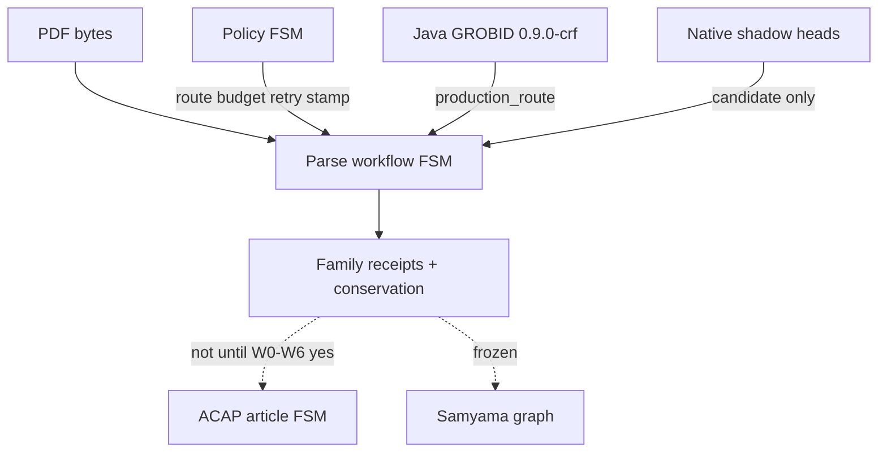

# ADR-076: GROBID Cascade Honesty — Three Automata, Waves W0–W6, Graph Frozen

- Status: Accepted
- Date: 2026-09-04
- Deciders: repository owner + agent (collaborative)
- Decisions: D321 (binding); inherits D127, D204, D294, D295, D316, D317
- Requirements: R118–R124 (new); inherits R105–R114, R116–R117
- Milestone: M465-sqt7w0
- Amends: ADR-075 (platform stays; cascade not replaced), ADR-074 (policy stamp on parse-pdf), ADR-055 (ACAP does not own parse)
- Binding level: binding for parse-plane sequencing until W0–W6 receipts exist
- Revisable: after W0 conservation ratchet and parse-pdf policy stamp are green; graph unfreeze needs a separate explicit yes
- Tags: grobid, da-parse, fsm, conservation, policy_hash, graph-freeze

## 0. One-line decision

> We will treat GROBID replacement as an honest Java cascade plus one-family native shadow waves, with three separate automata (parse workflow, policy FSM, ACAP).  
> We will not treat M464 completion as native GROBID in production, mix the three automata, write the scientific graph from parse waves, or use extraction F1 as the parse oracle.

## LLM Reading Notes

- ADR-075 still owns crate seams, Java-as-oracle, conservation-first promotion, and no JVM/SONA/ruVLLM inside `da-parse`. This ADR owns **sequencing and honesty**.
- M464 closed the **platform** (ParseBackend, envelope, dual cache, batch, shadow leaves). Production route remains `java-grobid-http@0.9.0-crf`.
- Three automata: parse workflow ≠ policy FSM ≠ ACAP. Policy chooses route/budget/retry only. It must not emit TEI fields.
- `da source sona-policy` is a demo. Process closure is `parse-pdf` stamping `policy_hash` or `policy=none` (R119, MEM930).
- `no_silent_loss=false` on tracked fixtures is a W0 fail, not an acceptable PASS (R120).
- Lexical `LayoutToken` donors must not emit `Image`/`Formula`. Visual heads use a separate bundle or typed absence (R122, D316).
- Official corpora without checksums stay `bytes_absent`. Executed denominator is the 3-document / 202-page proxy (D317).
- Graph / Samyama / ACAP materialization / `import_eligible` stay frozen for M465 (R118). Do not “just materialize” TEI.
- Governor health for this plane is absence of `scholarly_parse_plane_*` flags plus the W0 honesty gates (R124), not a clean TrajectoryVerdict (MEM1020).
- Do not create `data/scholarly_parse`. Bind `data/parse/grobid_compatibility.yaml` capability IDs (MEM1022).

## 1. Context

ADR-075 and M464-z84in2 shipped a staged native **platform**. The compatibility ledger still records the following **snapshot taken at decision time**; the ledger file itself is authoritative (current counts in §9.1):

| Ledger state | Count (2026-09-04 snapshot) | Meaning |
|---|---|---|
| `proxy` | 5 | Java HTTP we actually call (`isalive`, fulltext, header, references, teiCoordinates) |
| `fallback` | 6 | Internal cascade still inside the JAR (pdfalto, segmentation, header/refs composition, visual, consolidation) |
| `shadow` | 5 | Native leaves exist, disconnected from production `TeiLifter` |
| `candidate` | 2 | TEI lift + ruVLLM ablation aggregator |
| `absent` | 19 | Including required `GET /api/health` and `GET /api/version` |

> **Superseded snapshot (2026-09-10):** `proxy` 7 · `fallback` 1 · `shadow` 12 · `candidate` 2 · `absent` 16 = **38** capabilities in `data/parse/grobid_compatibility.yaml`. See §9.1.

Acceptance evidence can report `verdict=PASS` with `no_silent_loss=false` and `production_route=forbidden`. Native date/name/affiliation/citation/visual modules explicitly do not touch `TeiParseIr`. Layout donors populate only Word/Whitespace/Punctuation/Symbol while the enum also lists Image/Formula. Policy WASM is reachable from a demo CLI. Mixing that with ACAP article FSM and graph materialization would treat a Java proxy receipt as scientific truth.

Owner instruction: do not enter the graph until GROBID function is honest. Decompose the cascade to atoms, hang meta/prompt policy on stages, verify function then sequence, implement in waves.

### Context map

## 2. Decision

### We will

1. Keep three automata separate.
   - **Parse workflow** owns PDF → family receipts (P0–P9 below).
   - **Policy FSM** owns `grammar_route`, `profile_route`, `batch_admission`, `concurrency_tune`, `retry_policy`, later `head_fallback` / `visual_bundle` / `critic_sample`. Outputs are closed enums plus `policy_hash` or `policy=none`.
   - **ACAP** owns article-stage admission after parse receipts exist. Out of scope for M465.
2. Keep Java GROBID as production route and TEI oracle until a **single family** is explicitly promoted. Promotion still does not imply `import_eligible` or graph write.
3. Implement M465-sqt7w0 as waves W0–W6 = slices S01–S07. Each wave closes function, then sequence, then same-n replay. No graph write from those slices.
4. Extend `scholarly_parse_plane` governor gates for W0 honesty (R124) in the same change as DATA/fixtures SHA binds (MEM1019).
5. Replace native cascade **one family at a time** in order: lattice/segmentation → header atoms → bibliography atoms → body accounting → independent visual heads (R123).

### We will not

- Treat M464 complete as “GROBID replaced in Rust”.
- Emit TEI authors, DOIs, bboxes, or captions from a prompt or critic.
- Bind a product REST facade to Java `:8070`.
- Add MinerU / Docling / pdffigures2 / Python OCR as product sidecars.
- JNI-embed or fork Java GROBID.
- Use extraction F1 as parse acceptance.
- Count official OmniDocBench / publisher corpora as `executed_n` without checksums.
- Put SONA, ruVLLM, Samyama, or redb into `da-parse`.
- Unfreeze graph, ACAP materialization, or D127 from parse waves.
- Invent an XY-Cut CLI; stamp intent and keep `parse-pdf` (MEM930, ADR-072 as a **lane**).

### This decision authorizes

M465 planning and W0 governor taxonomy extensions. Shadow native sequences. Candidate-only learning receipts in RVF.

### This decision does not authorize

Production native ingest. Import. Graph writes. Auto-promote. SIMD without scalar equivalence. Live ruVLLM as quality evidence.

## 3. Parse workflow stages (P0–P9)

| ID | Stage | Production authority today | Native role | Hard fail |
|---|---|---|---|---|
| P0 | Admit, identity, profile | composition root | — | missing checksum / mixed rich+structural cache key |
| P1 | pdfalto / layout lattice | Java | shadow lattice (W1) | emitting Image/Formula from lexical donors |
| P2 | segmentation | Java | shadow regions (W1) | not exactly one region per admitted token |
| P3 | header heads | Java TEI lift | date→name→aff→compose (W2) | invented author |
| P4 | bibliography | Java listBibl | segment→fields→compose (W3) | lost_references |
| P5 | fulltext / sections | Java body | accountant composition only (W4) | changed_reading_order |
| P6 | figure / table / formula | Java TEI | independent visual heads (W5) | zero-count without visual bundle |
| P7 | coordinates / callouts | Java `teiCoordinates` | supporting | silent drop of boxes |
| P8 | consolidation | profile structural=off, rich=on | not in parse identity | Crossref inside structural fingerprint |
| P9 | envelope, lift, conservation | Java TEI + `TeiLifter` candidate | conservation ratchet (W0) | unaccounted family loss |

Each stage result is exactly one of: `java_ok` | `native_shadow` | `typed_absence` | `fail_visible`.

## 4. Waves = M465 slices

| Wave | Slice | Honesty target | Graph |
|---|---|---|---|
| W0 | S01 | health+version in identity; `no_silent_loss=true` on proxy; parse-pdf policy stamp; governor W0 negatives | frozen |
| W1 | S02 | lexical lattice + segmentation shadow | frozen |
| W2 | S03 | header atom sequence | frozen |
| W3 | S04 | bibliography sequence, consolidation off | frozen |
| W4 | S05 | body Java fallback, composition is accounting | frozen |
| W5 | S06 | independent visual heads, typed absence | frozen |
| W6 | S07 | policy/SMP on cascade; at most one family candidate-promote, `deployed=false` | frozen |

W0 is not a parser. It is the condition under which later waves are allowed to exist without lying.

Later families opened after M465 — callout matching, specialized consolidation, fulltext blocks, feature/tagger/training and REST batch/asset — are **not** part of W0–W6. They were opened as shadow families across M493–M501 with their own family-parity DATA contracts and `sNN_` quarantine scanners. Their absence from the table above is scope, not omission; see §9.2.

## 5. Governor W0 honesty gates

Extend `scripts/governor/checks/scholarly_parse_plane.yaml` (do not add a parallel ledger):

| Code | PASS | BLOCK |
|---|---|---|
| `ledger_surface` | capability `state` matches `implementation.surface` | proxy/shadow with `surface: none` |
| `backend_identity` | `rest.health` and `rest.version` not absent; version in cache fingerprint | TEI reused across Java upgrades |
| `policy_stamp` | parse-pdf has `policy_hash` or `policy=none` | stamp only from demo CLI |
| `silent_loss` | tracked proxy `no_silent_loss=true` | PASS with silent loss |
| `production_route` | ingest is Java while lock is forbidden | native on ingest |
| `graph_freeze` | no Samyama write from parse waves | any graph write |
| `denom_honesty` | no-checksum corpora = `bytes_absent` | executed_n on missing bytes |
| `dep_boundary` | `da-parse` Cargo has no SONA/ruVLLM/Samyama/redb | forbidden dep |
| `f1_not_oracle` | parse report separate from eval_batch | F1 used as parse PASS |

Existing locks remain: `import_eligible=false`, `auto_promote=forbidden`, `deployed=false`, `promotion_receipt=forbidden`, `graph_write=forbidden`.

## 6. Consequences

Positive: agents cannot read ADR-075 as “native GROBID is done”; W0 gates are fail-closed; visual/lexical lying is named; graph freeze is an ADR not a chat rule.

Costs: dual Java/native continues; M464 remains complete as platform history; M465 is new work; governor fixtures must SHA-bind on every DATA change.

## 7. Amendments to sibling ADRs

- **ADR-075 §6:** M464 completion evidence is platform closure, not cascade retirement. Native sequence §2.5 remains the destination; this ADR is the honesty gate before each step.
- **ADR-074:** WASM/MicroLoRA stay valid candidate packaging. Hot-path consult is parse-pdf (and FSM parsed-stage), fail-open, hashed. `summary_depth` is not a parse-wave decision.
- **ADR-055:** ACAP does not admit parse-family substitution. Parse receipts are candidate evidence until a later explicit yes.
- **ADR-072:** XY-Cut is a layout **lane** under W1, not a product parser and not a new CLI.

## 8. References

- ADR-075, ADR-074, ADR-055, ADR-072, ADR-051 §8.1 (graph tasks stay out of these waves)
- D321, D127, D204, D316, D317, D294, D295
- R118–R124, R105–R117
- `data/parse/grobid_compatibility.yaml`
- `scripts/governor/checks/scholarly_parse_plane.yaml`
- M465-sqt7w0

## 9. Dated corrections (2026-09-10) — added by M502-2w7y8k/S01

This section records documentary drift found during the 2026-09-08…09-10 absorption review. It corrects the **snapshot text** above; it does not change the decision in §2, and it is not a new decision.

### 9.1 Ledger counts moved

| Ledger state | §1 snapshot (2026-09-04) | Actual (2026-09-10) |
|---|---|---|
| `proxy` | 5 | **7** (adds `rest.health`, `rest.version`) |
| `fallback` | 6 | **1** (`bibliographic_consolidation` profile selection only) |
| `shadow` | 5 | **12** |
| `candidate` | 2 | 2 |
| `absent` | 19 | **16** |
| total | 37 | **38** |

The `fallback → shadow` reclassification is justified by added native modules plus shadow receipts, not by weakening the gate. `rest.health`/`rest.version` are no longer `absent`, which is what R121 requires.

### 9.2 Later families live outside W0–W6

Callout matching, specialized consolidation, fulltext blocks, feature/tagger/training and REST batch/asset were opened as shadow families in M493–M501, each with a family-parity DATA contract, an independent oracle and a unique `sNN_` quarantine scanner. None is wired into `parse-pdf`, so their production status is unchanged: Java remains the only production authority.

### 9.3 Open correctness findings are tracked outside this ADR

ADR-076 owns **sequencing and honesty**; it deliberately does not enumerate measurements. The 2026-09-10 registry `doc/review/grobid-absorption-review-2026-09-10.jsonl` (GAR-001…GAR-016; 15 unresolved / 1 superseded) owns them under programme `M502-2w7y8k`. Among them: boundary metrics measure counts rather than positions (GAR-001), P9 emits a historic `conserved` verdict beside `computed_this_run=false` (GAR-005), synthetic executions share report space with corpus denominators (GAR-006), and oracle digests are not recomputable from source bytes (GAR-011). Executable guarantees belong in DATA contracts, scanners and fixtures — not in ADR prose.

### 9.4 Ledger fields still missing

No capability row in `data/parse/grobid_compatibility.yaml` carries a `license` field. Only `defaults.baseline.license=Apache-2.0` (Java GROBID) exists, and `defaults.candidate.license` holds the non-license string `project`. pdfalto is GPLv2. R137 requires per-component license/provenance/redistribution evidence; it is owned by M502-2w7y8k/S07 (GAR-004).

## 10. Dated corrections (2026-09-17) — added by M508-g9b5gi/S05

This section is the 2026-09-17 dated correction and follows the §9 convention: it adds a new dated snapshot rather than rewriting §9.3/§9.4, which remain the 2026-09-10 record.

The GAR register `doc/review/grobid-absorption-review-2026-09-10.jsonl` now reports **11 unresolved / 5 enclosed**. Wave `M508-g9b5gi/S05` closed four P0 findings (GAR-001, GAR-003, GAR-004, GAR-011) by acknowledging controls that slices S01..S04 had already delivered and by attaching machine-verifiable `completion_evidence` to each record; the fifth enclosed record is the pre-existing GAR-002 supersession. Coverage for GAR-004 and GAR-011 stays `partial`: the closed verified-license dictionary lives only in the Rust reader, and the sha256 mathematics is recomputed by the independent Rust contract.

§9.3 remains the dated 2026-09-10 snapshot and is not amended. This correction changes no decision in §2 and weakens no lock: `deployed=false`, `import_eligible=false`, `auto_promote` remains forbidden, and there is still no production splice.

## 11. Dated corrections (2026-09-18) — added by M509-yzblqx/S07

This section follows the §9/§10 convention: it adds a new dated snapshot rather than rewriting §9 or §10, which remain the 2026-09-10 and 2026-09-17 records.

The GAR register `doc/review/grobid-absorption-review-2026-09-10.jsonl` now reads **3 unresolved / 13 enclosed**. Wave `M509-yzblqx` closed the eight P1 findings (GAR-005..GAR-009, GAR-012..GAR-014) through slices S01..S05 by attaching six-key `completion_evidence` (mode, ref, result, artifacts, observed_at, source_revision) to each record, at source revision `git:2871d87c9c9e4d46f49d76edeb2e6c33f17ba970`. Together with the four P0 closures recorded in §10 and the pre-existing GAR-002 supersession this leaves thirteen enclosed records. The three unresolved records are the P2 findings GAR-010, GAR-015 and GAR-016, carried by name in `doc/review/manifest.yaml` under `long_horizon.next_wave`.

Ownership now names the delivering waves: `doc/review/manifest.yaml` records GAR-005 and GAR-009 under M509-yzblqx/S01, GAR-006 under S02, GAR-007 and GAR-008 under S03, GAR-012 and GAR-014 under S04, and GAR-013 under S05, matching the registry's `assessment.owning_wave` values; the remaining open P2 items keep their `M502-2w7y8k` owners.

The register's human-facing prose (`doc/review/README.md`,
`doc/review/grobid-absorption-review-2026-09-10-summary.md`) states the same
3 unresolved / 13 enclosed counts and the M509 ownership. `governor review`
reports `records=16 unresolved=3 enclosed=13 unassigned_unresolved=0`.

No lock changed: `deployed=false`, `import_eligible=false`, `auto_promote`
remains forbidden, there is no production splice, and D127 stays closed. §9.3
and §10 remain dated snapshots and are not amended.
