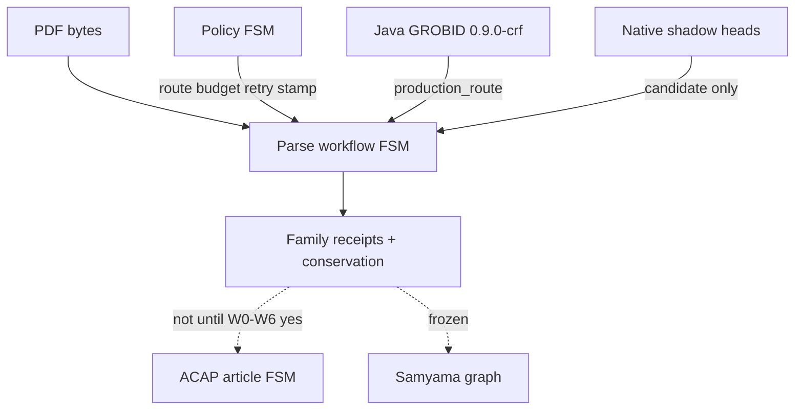

# ADR-076: GROBID Cascade Honesty — Three Automata, Waves W0–W6, Graph Frozen

- Status: Accepted
- Date: 2026-09-04
- Deciders: repository owner + agent (collaborative)
- Decisions: D321 (binding); inherits D127, D204, D294, D295, D316, D317
- Requirements: R118–R124 (new); inherits R105–R114, R116–R117
- Milestone: M465-sqt7w0
- Amends: ADR-075 (platform stays; cascade not replaced), ADR-074 (policy stamp on parse-pdf), ADR-055 (ACAP does not own parse)
- Binding level: binding for parse-plane sequencing until W0–W6 receipts exist
- Revisable: after W0 conservation ratchet and parse-pdf policy stamp are green; graph unfreeze needs a separate explicit yes
- Tags: grobid, da-parse, fsm, conservation, policy_hash, graph-freeze

## 0. One-line decision

> We will treat GROBID replacement as an honest Java cascade plus one-family native shadow waves, with three separate automata (parse workflow, policy FSM, ACAP).  
> We will not treat M464 completion as native GROBID in production, mix the three automata, write the scientific graph from parse waves, or use extraction F1 as the parse oracle.

## LLM Reading Notes

- ADR-075 still owns crate seams, Java-as-oracle, conservation-first promotion, and no JVM/SONA/ruVLLM inside `da-parse`. This ADR owns **sequencing and honesty**.
- M464 closed the **platform** (ParseBackend, envelope, dual cache, batch, shadow leaves). Production route remains `java-grobid-http@0.9.0-crf`.
- Three automata: parse workflow ≠ policy FSM ≠ ACAP. Policy chooses route/budget/retry only. It must not emit TEI fields.
- `da source sona-policy` is a demo. Process closure is `parse-pdf` stamping `policy_hash` or `policy=none` (R119, MEM930).
- `no_silent_loss=false` on tracked fixtures is a W0 fail, not an acceptable PASS (R120).
- Lexical `LayoutToken` donors must not emit `Image`/`Formula`. Visual heads use a separate bundle or typed absence (R122, D316).
- Official corpora without checksums stay `bytes_absent`. Executed denominator is the 3-document / 202-page proxy (D317).
- Graph / Samyama / ACAP materialization / `import_eligible` stay frozen for M465 (R118). Do not “just materialize” TEI.
- Governor health for this plane is absence of `scholarly_parse_plane_*` flags plus the W0 honesty gates (R124), not a clean TrajectoryVerdict (MEM1020).
- Do not create `data/scholarly_parse`. Bind `data/parse/grobid_compatibility.yaml` capability IDs (MEM1022).

## 1. Context

ADR-075 and M464-z84in2 shipped a staged native **platform**. The compatibility ledger still records the following **snapshot taken at decision time**; the ledger file itself is authoritative (current counts in §9.1):

| Ledger state | Count (2026-09-04 snapshot) | Meaning |
|---|---|---|
| `proxy` | 5 | Java HTTP we actually call (`isalive`, fulltext, header, references, teiCoordinates) |
| `fallback` | 6 | Internal cascade still inside the JAR (pdfalto, segmentation, header/refs composition, visual, consolidation) |
| `shadow` | 5 | Native leaves exist, disconnected from production `TeiLifter` |
| `candidate` | 2 | TEI lift + ruVLLM ablation aggregator |
| `absent` | 19 | Including required `GET /api/health` and `GET /api/version` |

> **Superseded snapshot (2026-09-10):** `proxy` 7 · `fallback` 1 · `shadow` 12 · `candidate` 2 · `absent` 16 = **38** capabilities in `data/parse/grobid_compatibility.yaml`. See §9.1.

Acceptance evidence can report `verdict=PASS` with `no_silent_loss=false` and `production_route=forbidden`. Native date/name/affiliation/citation/visual modules explicitly do not touch `TeiParseIr`. Layout donors populate only Word/Whitespace/Punctuation/Symbol while the enum also lists Image/Formula. Policy WASM is reachable from a demo CLI. Mixing that with ACAP article FSM and graph materialization would treat a Java proxy receipt as scientific truth.

Owner instruction: do not enter the graph until GROBID function is honest. Decompose the cascade to atoms, hang meta/prompt policy on stages, verify function then sequence, implement in waves.

### Context map

## 2. Decision

### We will

1. Keep three automata separate.
   - **Parse workflow** owns PDF → family receipts (P0–P9 below).
   - **Policy FSM** owns `grammar_route`, `profile_route`, `batch_admission`, `concurrency_tune`, `retry_policy`, later `head_fallback` / `visual_bundle` / `critic_sample`. Outputs are closed enums plus `policy_hash` or `policy=none`.
   - **ACAP** owns article-stage admission after parse receipts exist. Out of scope for M465.
2. Keep Java GROBID as production route and TEI oracle until a **single family** is explicitly promoted. Promotion still does not imply `import_eligible` or graph write.
3. Implement M465-sqt7w0 as waves W0–W6 = slices S01–S07. Each wave closes function, then sequence, then same-n replay. No graph write from those slices.
4. Extend `scholarly_parse_plane` governor gates for W0 honesty (R124) in the same change as DATA/fixtures SHA binds (MEM1019).
5. Replace native cascade **one family at a time** in order: lattice/segmentation → header atoms → bibliography atoms → body accounting → independent visual heads (R123).

### We will not

- Treat M464 complete as “GROBID replaced in Rust”.
- Emit TEI authors, DOIs, bboxes, or captions from a prompt or critic.
- Bind a product REST facade to Java `:8070`.
- Add MinerU / Docling / pdffigures2 / Python OCR as product sidecars.
- JNI-embed or fork Java GROBID.
- Use extraction F1 as parse acceptance.
- Count official OmniDocBench / publisher corpora as `executed_n` without checksums.
- Put SONA, ruVLLM, Samyama, or redb into `da-parse`.
- Unfreeze graph, ACAP materialization, or D127 from parse waves.
- Invent an XY-Cut CLI; stamp intent and keep `parse-pdf` (MEM930, ADR-072 as a **lane**).

### This decision authorizes

M465 planning and W0 governor taxonomy extensions. Shadow native sequences. Candidate-only learning receipts in RVF.

### This decision does not authorize

Production native ingest. Import. Graph writes. Auto-promote. SIMD without scalar equivalence. Live ruVLLM as quality evidence.

## 3. Parse workflow stages (P0–P9)

| ID | Stage | Production authority today | Native role | Hard fail |
|---|---|---|---|---|
| P0 | Admit, identity, profile | composition root | — | missing checksum / mixed rich+structural cache key |
| P1 | pdfalto / layout lattice | Java | shadow lattice (W1) | emitting Image/Formula from lexical donors |
| P2 | segmentation | Java | shadow regions (W1) | not exactly one region per admitted token |
| P3 | header heads | Java TEI lift | date→name→aff→compose (W2) | invented author |
| P4 | bibliography | Java listBibl | segment→fields→compose (W3) | lost_references |
| P5 | fulltext / sections | Java body | accountant composition only (W4) | changed_reading_order |
| P6 | figure / table / formula | Java TEI | independent visual heads (W5) | zero-count without visual bundle |
| P7 | coordinates / callouts | Java `teiCoordinates` | supporting | silent drop of boxes |
| P8 | consolidation | profile structural=off, rich=on | not in parse identity | Crossref inside structural fingerprint |
| P9 | envelope, lift, conservation | Java TEI + `TeiLifter` candidate | conservation ratchet (W0) | unaccounted family loss |

Each stage result is exactly one of: `java_ok` | `native_shadow` | `typed_absence` | `fail_visible`.

## 4. Waves = M465 slices

| Wave | Slice | Honesty target | Graph |
|---|---|---|---|
| W0 | S01 | health+version in identity; `no_silent_loss=true` on proxy; parse-pdf policy stamp; governor W0 negatives | frozen |
| W1 | S02 | lexical lattice + segmentation shadow | frozen |
| W2 | S03 | header atom sequence | frozen |
| W3 | S04 | bibliography sequence, consolidation off | frozen |
| W4 | S05 | body Java fallback, composition is accounting | frozen |
| W5 | S06 | independent visual heads, typed absence | frozen |
| W6 | S07 | policy/SMP on cascade; at most one family candidate-promote, `deployed=false` | frozen |

W0 is not a parser. It is the condition under which later waves are allowed to exist without lying.

Later families opened after M465 — callout matching, specialized consolidation, fulltext blocks, feature/tagger/training and REST batch/asset — are **not** part of W0–W6. They were opened as shadow families across M493–M501 with their own family-parity DATA contracts and `sNN_` quarantine scanners. Their absence from the table above is scope, not omission; see §9.2.

## 5. Governor W0 honesty gates

Extend `scripts/governor/checks/scholarly_parse_plane.yaml` (do not add a parallel ledger):

| Code | PASS | BLOCK |
|---|---|---|
| `ledger_surface` | capability `state` matches `implementation.surface` | proxy/shadow with `surface: none` |
| `backend_identity` | `rest.health` and `rest.version` not absent; version in cache fingerprint | TEI reused across Java upgrades |
| `policy_stamp` | parse-pdf has `policy_hash` or `policy=none` | stamp only from demo CLI |
| `silent_loss` | tracked proxy `no_silent_loss=true` | PASS with silent loss |
| `production_route` | ingest is Java while lock is forbidden | native on ingest |
| `graph_freeze` | no Samyama write from parse waves | any graph write |
| `denom_honesty` | no-checksum corpora = `bytes_absent` | executed_n on missing bytes |
| `dep_boundary` | `da-parse` Cargo has no SONA/ruVLLM/Samyama/redb | forbidden dep |
| `f1_not_oracle` | parse report separate from eval_batch | F1 used as parse PASS |

Existing locks remain: `import_eligible=false`, `auto_promote=forbidden`, `deployed=false`, `promotion_receipt=forbidden`, `graph_write=forbidden`.

## 6. Consequences

Positive: agents cannot read ADR-075 as “native GROBID is done”; W0 gates are fail-closed; visual/lexical lying is named; graph freeze is an ADR not a chat rule.

Costs: dual Java/native continues; M464 remains complete as platform history; M465 is new work; governor fixtures must SHA-bind on every DATA change.

## 7. Amendments to sibling ADRs

- **ADR-075 §6:** M464 completion evidence is platform closure, not cascade retirement. Native sequence §2.5 remains the destination; this ADR is the honesty gate before each step.
- **ADR-074:** WASM/MicroLoRA stay valid candidate packaging. Hot-path consult is parse-pdf (and FSM parsed-stage), fail-open, hashed. `summary_depth` is not a parse-wave decision.
- **ADR-055:** ACAP does not admit parse-family substitution. Parse receipts are candidate evidence until a later explicit yes.
- **ADR-072:** XY-Cut is a layout **lane** under W1, not a product parser and not a new CLI.

## 8. References

- ADR-075, ADR-074, ADR-055, ADR-072, ADR-051 §8.1 (graph tasks stay out of these waves)
- D321, D127, D204, D316, D317, D294, D295
- R118–R124, R105–R117
- `data/parse/grobid_compatibility.yaml`
- `scripts/governor/checks/scholarly_parse_plane.yaml`
- M465-sqt7w0

## 9. Dated corrections (2026-09-10) — added by M502-2w7y8k/S01

This section records documentary drift found during the 2026-09-08…09-10 absorption review. It corrects the **snapshot text** above; it does not change the decision in §2, and it is not a new decision.

### 9.1 Ledger counts moved

| Ledger state | §1 snapshot (2026-09-04) | Actual (2026-09-10) |
|---|---|---|
| `proxy` | 5 | **7** (adds `rest.health`, `rest.version`) |
| `fallback` | 6 | **1** (`bibliographic_consolidation` profile selection only) |
| `shadow` | 5 | **12** |
| `candidate` | 2 | 2 |
| `absent` | 19 | **16** |
| total | 37 | **38** |

The `fallback → shadow` reclassification is justified by added native modules plus shadow receipts, not by weakening the gate. `rest.health`/`rest.version` are no longer `absent`, which is what R121 requires.

### 9.2 Later families live outside W0–W6

Callout matching, specialized consolidation, fulltext blocks, feature/tagger/training and REST batch/asset were opened as shadow families in M493–M501, each with a family-parity DATA contract, an independent oracle and a unique `sNN_` quarantine scanner. None is wired into `parse-pdf`, so their production status is unchanged: Java remains the only production authority.

### 9.3 Open correctness findings are tracked outside this ADR

ADR-076 owns **sequencing and honesty**; it deliberately does not enumerate measurements. The 2026-09-10 registry `doc/review/grobid-absorption-review-2026-09-10.jsonl` (GAR-001…GAR-016; 15 unresolved / 1 superseded) owns them under programme `M502-2w7y8k`. Among them: boundary metrics measure counts rather than positions (GAR-001), P9 emits a historic `conserved` verdict beside `computed_this_run=false` (GAR-005), synthetic executions share report space with corpus denominators (GAR-006), and oracle digests are not recomputable from source bytes (GAR-011). Executable guarantees belong in DATA contracts, scanners and fixtures — not in ADR prose.

### 9.4 Ledger fields still missing

No capability row in `data/parse/grobid_compatibility.yaml` carries a `license` field. Only `defaults.baseline.license=Apache-2.0` (Java GROBID) exists, and `defaults.candidate.license` holds the non-license string `project`. pdfalto is GPLv2. R137 requires per-component license/provenance/redistribution evidence; it is owned by M502-2w7y8k/S07 (GAR-004).

## 10. Dated corrections (2026-09-17) — added by M508-g9b5gi/S05

This section is the 2026-09-17 dated correction and follows the §9 convention: it adds a new dated snapshot rather than rewriting §9.3/§9.4, which remain the 2026-09-10 record.

The GAR register `doc/review/grobid-absorption-review-2026-09-10.jsonl` now reports **11 unresolved / 5 enclosed**. Wave `M508-g9b5gi/S05` closed four P0 findings (GAR-001, GAR-003, GAR-004, GAR-011) by acknowledging controls that slices S01..S04 had already delivered and by attaching machine-verifiable `completion_evidence` to each record; the fifth enclosed record is the pre-existing GAR-002 supersession. Coverage for GAR-004 and GAR-011 stays `partial`: the closed verified-license dictionary lives only in the Rust reader, and the sha256 mathematics is recomputed by the independent Rust contract.

§9.3 remains the dated 2026-09-10 snapshot and is not amended. This correction changes no decision in §2 and weakens no lock: `deployed=false`, `import_eligible=false`, `auto_promote` remains forbidden, and there is still no production splice.

## 11. Dated corrections (2026-09-18) — added by M509-yzblqx/S07

This section follows the §9/§10 convention: it adds a new dated snapshot rather than rewriting §9 or §10, which remain the 2026-09-10 and 2026-09-17 records.

The GAR register `doc/review/grobid-absorption-review-2026-09-10.jsonl` now reads **3 unresolved / 13 enclosed**. Wave `M509-yzblqx` closed the eight P1 findings (GAR-005..GAR-009, GAR-012..GAR-014) through slices S01..S05 by attaching six-key `completion_evidence` (mode, ref, result, artifacts, observed_at, source_revision) to each record, at source revision `git:2871d87c9c9e4d46f49d76edeb2e6c33f17ba970`. Together with the four P0 closures recorded in §10 and the pre-existing GAR-002 supersession this leaves thirteen enclosed records. The three unresolved records are the P2 findings GAR-010, GAR-015 and GAR-016, carried by name in `doc/review/manifest.yaml` under `long_horizon.next_wave`.

Ownership now names the delivering waves: `doc/review/manifest.yaml` records GAR-005 and GAR-009 under M509-yzblqx/S01, GAR-006 under S02, GAR-007 and GAR-008 under S03, GAR-012 and GAR-014 under S04, and GAR-013 under S05, matching the registry's `assessment.owning_wave` values; the remaining open P2 items keep their `M502-2w7y8k` owners.

The register's human-facing prose (`doc/review/README.md`,
`doc/review/grobid-absorption-review-2026-09-10-summary.md`) states the same
3 unresolved / 13 enclosed counts and the M509 ownership. `governor review`
reports `records=16 unresolved=3 enclosed=13 unassigned_unresolved=0`.

No lock changed: `deployed=false`, `import_eligible=false`, `auto_promote`
remains forbidden, there is no production splice, and D127 stays closed. §9.3
and §10 remain dated snapshots and are not amended.

## 12. Dated corrections (2026-09-19) — added by M510-jsg1pj/S04

This section follows the §9/§10/§11 convention: it adds a new dated snapshot
rather than rewriting §9.3, §10 or §11, which remain the 2026-09-10,
2026-09-17 and 2026-09-18 records.

The GAR register `doc/review/grobid-absorption-review-2026-09-10.jsonl` now
reads **1 unresolved / 15 enclosed**. Wave `M510-jsg1pj` closed its two
code-deliverable P2 findings, each on a check re-executed at this revision
rather than on the wave plan or on prose:

- **GAR-016** (UAT verdict lineage is not machine-checked) — closed by
  `M510-jsg1pj/S01`, whose recorded command is
  `cargo test -p da-cli --test uat_verdict_lineage` (10 passed, 0 failed). A
  report-producing shadow-test PASS is now a bounded verdict bound to the
  command, inputs, parsed assertions, artifact digests and source revision
  that produced it; a changed command, input digest, artifact digest, parsed
  assertion or source revision fails the verdict instead of passing, and an
  execution verdict does not imply parity or quality. `governor.coverage`
  stays `gap`: no governor rule named `uat_verdict_lineage` was built, so the
  closure rests on command evidence and that proposal stays named as a
  proposal.
- **GAR-010** (Meta-prompt normatives lack a machine-checkable authority and
  change-control model) — closed by `M510-jsg1pj/S02`, whose recorded check is
  the `prompt_normative_contract` governor rule reached through the normal
  build_report path (`PYTHONPATH=scripts python3 -m governor --phase preflight`
  exits 0 with zero `prompt_normative_contract` flags on the committed tree),
  together with `PYTHONPATH=scripts python3 -m pytest
  scripts/tests/test_governor.py -k prompt_normative -q` (21 passed).
  Obligations are identified in DATA with scope, authority, preconditions and
  an evidence obligation; verification operations are allowlisted typed
  identifiers, so a shell-string operation is not representable; dropping,
  weakening to `should`, renaming, or writing an obligation as descriptive
  material fails closed; and the optimizer-immutable proof/authority/evidence
  boundaries are pinned. `governor.coverage` moves `gap` → `existing` because
  that rule exists on disk.

Both closures carry six-key `completion_evidence` (`mode`, `ref`, `result`,
`artifacts`, `observed_at`, `source_revision`) at source revision
`git:c2191476e497b2e0bc53888342f163654dd31a99`, observed 2026-09-19, and both
name their delivering slice in `assessment.owning_wave`. Those slices were
added to the registry owner vocabulary in
`scripts/governor/checks/grobid_absorption_review.yaml` in the same change, so
naming the delivering wave is accepted rather than aspirational — an unknown
owner still fails closed with `grobid_review_registry_broken` and exit 2.
`PYTHONPATH=scripts python3 -m governor review --registry
scripts/governor/checks/grobid_absorption_review.yaml` reports
`records=16 unresolved=1 enclosed=15 unassigned_unresolved=0`; the fifteen
enclosed records are the four P0 closures of §10, the eight P1 closures of §11,
the pre-existing GAR-002 supersession, and these two P2 closures.

The single unresolved record is GAR-015 (external holdout remains unexecuted
with no acceptance statistics or release evidence). This correction leaves it
unresolved: GAR-015's recorded verification includes a `human`-mode release
review decision, and no automated check may read that decision on a reviewer's
behalf. §11 remains the 2026-09-18 snapshot of a three-finding P2 remainder;
this entry supersedes only that count, not the record.

No lock changed: `deployed=false`, `import_eligible=false`, `auto_promote`
remains forbidden, `this_wave_promotes=none`, there is no production splice,
and D127 stays closed. §9.3, §10 and §11 remain dated snapshots and are not
amended.

## 13. Dated corrections (2026-09-19) — added by M510-jsg1pj/S04

This section follows the §9/§10/§11/§12 convention: it adds a new dated
snapshot rather than rewriting §9.3, §10, §11 or §12.

GAR-015 (external holdout remains unexecuted with no acceptance statistics or
release evidence) is recorded as an **accepted open item**, not as a closure.
No closure is claimable: the bounded external holdout package is declared and
machine-checked in `data/parse/acceptance_manifest.yaml`
(`external_holdout_contract` — acceptance margins, a per-document uncertainty
method, transfer latency/cost accounting, a probe identity frozen apart from
production corpora, retire-on-change invalidation rules, and a fail-closed
citation/release gate; `release_decision_package` — the three release gates),
and the `external_holdout_package` DATA rule enforces it, but
`external_holdout_contract.execution_status` is `not_executed` and
`release_decision_package.human_release_review.decision` is `pending` with
`reviewer: null`. Both of the record's verification entries — the artifact
`external-holdout-package` and the human `release-review-decision` — are
therefore unsatisfied, and `bytes_absent` external rows stay non-evidence.

- **Owner:** `M502-2w7y8k/S09`, the package owner of record that delivered the
  release decision package. No owner is invented: no live slice owns the probe
  execution or the named human decision, and `M510-jsg1pj/S03` delivered only
  the declaration.
- **Reason it is open:** no executed frozen external probe and no recorded
  human release decision exist.
- **Closure condition:** execute the frozen probe apart from production corpora
  with the declared per-document margins and publish probe identity, statistics,
  cost/latency and invalidation rules as one package, then record a named human
  reviewer's release decision. Citation stays blocked until both exist.
- **No rewording:** the record's claim, title, risk, remediation and acceptance
  criteria are unchanged; `status` stays `open`, and only the
  `assessment` note, date and source revision were updated.

The live human-facing prose (`doc/review/README.md`,
`doc/review/grobid-absorption-review-2026-09-10-summary.md`) and
`doc/review/manifest.yaml` (the owners map, `current_state` and
`long_horizon.next_wave`) were reconciled to the same measured state: GAR-010
and GAR-016 are enclosed with the delivering slices named as their owners
(`M510-jsg1pj/S02` and `M510-jsg1pj/S01`), and GAR-015 is the single open
record, carried as an accepted open item with its owner, reason and closure
condition. `PYTHONPATH=scripts python3 -m governor review --registry
scripts/governor/checks/grobid_absorption_review.yaml` reports
`records=16 unresolved=1 enclosed=15 unassigned_unresolved=0`.

No lock changed: `deployed=false`, `import_eligible=false`, `auto_promote`
remains forbidden, `this_wave_promotes=none`, there is no production splice,
and D127 stays closed. §9.3, §10, §11 and §12 remain dated snapshots and are
not amended.

## 14. Корректировка 2026-09-21: semantic correctness до расширения допуска

Аудит `doc/review/grobid-absorption-audit-2026-09-21.md` на `bcdd0cfc5`
воспроизвёл Accepted с невалидным XML на трёх реальных TEI и Accepted с
висячим body target `#b0` при пустых supplied anchors. Production-достижимость
не доказана: проверялся публичный shadow-композитор. 1351 зелёный тест da-parse
не заменяет независимого разбора выходного документа.

Владелец разрешил техническую волну **M511-j7wz2f**, S01–S09:
H14→S01 XML; H15→S02 ссылки; H16→S03 поля/fallback; H17→S04 visual/accounting;
H18→S05 корпус; H19→S06 остаток H05; H20→S08 external probe;
H21→S07 Java/Rust parity ledger; S09 интеграция и согласование документов.

- Accepted требует корректного XML и разрешимых локальных bibliography targets;
  source identity, body conservation и безопасный fallback не ослабляются.
- Процент миграции нельзя выводить из LOC, закрытых задач или production=0.
  Нужна связь pinned Java behavior → Rust symbol → независимое доказательство.
- 38 license references не означают blanket legal clearance; blocked-компоненты
  license_inventory сохраняются.
- Пятистатейный пилот не заменяет frozen external probe. GAR-015 остаётся открыт
  до реального human release decision; auto не фабрикует reviewer или ответ.
- Исторические H01–H13/GAR closure не переписываются задним числом.

Planning registry проверяется существующим `horizon-json-v1`:
`PYTHONPATH=scripts python3 -m governor review --registry doc/review/grobid-absorption-roadmap-2026-09-21.yaml`.
Успех команды означает целостность плана, не выполнение задач. GSD — источник
плана исполнения. Замки сохранены: `deployed=false`, `import_eligible=false`,
`auto_promote=forbidden`, `graph_write=forbidden`, `this_wave_promotes=none`.
Разрешение M511 не является разрешением снять D127.

- S01/T01 (измерение, не исправление): диагностический probe аудита превращён в
  отслеживаемую регрессию `crates/da-parse/tests/native_fulltext_composition_contract.rs`
  с независимым парсером `roxmltree` **только** как dev-dependency (прод-import-root
  композитора `{crate, serde, sha2, std}` не изменён). Замеренный RED (Accepted при
  невалидном XML на трёх сохранённых TEI) запиннен дефолтным тестом; целевой гейт
  `preserved_tei_composition_is_independently_well_formed` остаётся `#[ignore]`/RED.
  H14 не закрывается: `header_xml`/`preserve_header_children` не изменялись,
  `implementation_pass=false`, замки и D127/D321 не трогались.
- S01/T02 (исправление, RED→GREEN): `XmlDocument` спаривает открывающие и
  закрывающие теги одним стеком, поэтому диапазон всегда начинается с
  открывающего тега; содержимое заголовка переразмещается по родителю
  (`titleStmt` → в синтезированный `titleStmt`, `fileDesc` без `titleStmt` → в
  синтезированный `fileDesc`, остальные дети `teiHeader` → после него — попарно
  непересекающиеся и полные), атрибуты исходного `<teiHeader>` воспроизводятся
  дословно, и эмиссия перечитывается до `Accepted`
  (`ComposedOutputNotWellFormed`), иначе возвращается байт-идентичный
  Java-envelope. Гейт `preserved_tei_composition_is_independently_well_formed`
  больше не `#[ignore]`; независимый `roxmltree` (dev-dependency, prod
  import-root `{crate, serde, sha2, std}` не изменён) принимает эмиссии трёх
  сохранённых TEI. Замер: `cargo test -p da-parse --tests` → 100 suites /
  1359 passed / 0 failed / 0 ignored. H14 не закрывается этой записью:
  `implementation_pass=false` и planning-семантика реестра сохраняются.
- S01/T03 (интеграция и границы): обязательная для T03 проверка
  namespace-негативов воспроизвела остаточный дефект того же класса —
  объявление `xmlns:ext` на **синтезируемых** обёртках `fileDesc`/`titleStmt`
  не воспроизводилось, поэтому композитор возвращал `Accepted` при эмиссии,
  отвергаемой независимым парсером (`an unknown namespace prefix 'ext' at 1:202`
  и `1:153`; gsd_exec `c9cbe8d7-b4dc-492a-aa7d-ab7134a5335b`). Закрыто узко:
  с этих двух обёрток переносятся только `xmlns`/`xmlns:*`; прочие атрибуты
  обёрток (в том числе собственный `xml:lang`) по-прежнему не копируются — это
  семантический остаток поля (H16), не well-formedness. Регрессия
  `wrapper_namespace_declarations_are_carried_so_no_prefix_is_unbound`.
  Malformed-набор расширен лишним закрывающим тегом, незавершённым комментарием
  и незавершённой CDATA. Shadow-пример проверен сборкой и реальным прогоном под
  обязательной фичей `pdf-layout`: без неё `cargo check -p da-cli --example
  native_fulltext_composition_shadow` даёт rc=101 (`target … requires the
  features`), поэтому план-команда адаптирована, а не «зелёная пустота».
  Реестр проверен существующим `horizon-json-v1`: `governor review --registry
  doc/review/grobid-absorption-roadmap-2026-09-21.yaml` → exit=0, схема
  `grobid-rust-horizon-review.schema.json` → schema-ok. Замки не менялись:
  `deployed=false`, `import_eligible=false`, `auto_promote=forbidden`,
  `graph_write=forbidden`, `this_wave_promotes=none`, D127/D321 закрыты.
  H14 остаётся planning-записью с `implementation_pass=false`: замеренная
  область зелёная, но закрытие этапа не фабрикуется.

## 15. Корректировка 2026-09-21 (продолжение): T04–T06 и актуальный замер

Разделы §14 остаются записью своих ревизий и не переписываются: счётчики
«17 contract-тестов / 1359 passed» описывают ревизию S01/T03. Ниже — что
изменилось дальше и что измерено сейчас.

- S01/T04 (WF-проход отдельно от сканера): эмиссия больше не считается
  корректной по самоудостоверению. `validate_well_formed` — отдельный проход по
  конкретным WFC-классам (ровно один корневой элемент, легальность `Name`/`QName`,
  список атрибутов в форме `Name S? Eq S? AttValue` с кавычками и без дублей,
  ссылки `&`/`&#…;`, `]]>` в CharData, `--` в комментарии, CDATA только внутри
  документа, лимит глубины, легальные XML-символы, привязка префиксов), а
  инвариант «`Accepted` ⇒ эмиссия разбирается независимым парсером» закреплён
  property-тестом. Исторический RED этого класса (потеря объявления
  `xmlns:ext = "urn:x"`) снят в T04.
- S01/T05 (структурная консервация): обёртки консервируются байтовыми
  интервалами минус исключённые ПРЯМЫЕ дети — комментарии, processing instruction
  и текст/whitespace между детьми не теряются, а поиск wrapper'а ограничен прямыми
  детьми, поэтому вложенный `titleStmt` не дублируется.
- S01/T06 (два измеренных остатка закрыты, лимиты запиннены): (1) `xml:id` с
  одиночными кавычками или пробелами вокруг `=` обходил uniqueness-гейт, и
  эмиссия публиковалась как `Accepted` с двумя `xml:id="author-0"`
  (gsd_exec `b9a3be53-e685-41c7-ba48-f66674baad41`) — атрибуты читаются
  XML-грамматикой, нечитаемый список даёт `MalformedXml` (fail-closed); (2)
  `<!DOCTYPE`/`<!ENTITY` искались подстрокой по всему документу, поэтому
  упоминание строки в комментарии или CDATA отвергалось как
  `ForbiddenExternalEntity` — детекция стала markup-aware без ослабления гейта
  (реальный `<!DOCTYPE` запрещён, `<!doctype` отклоняется как нелегальная
  разметка, `<!DOCTYPE` в значении атрибута — по правилу `AttValue`); (3) лимиты
  4 MiB (фрагмент) и 128 (глубина XML) воспроизведённого дефекта не имели и
  запиннены регрессией как уже корректные (типизированный отказ,
  байт-идентичный Java-envelope, без частичного вывода).
- Актуальный замер: `cargo test -p da-parse --test
  native_fulltext_composition_contract` — 28 passed / 0 ignored;
  `native_fulltext_composition_properties` — 8 passed; `cargo test -p da-parse
  --tests` — 100 suites / 1374 passed / 0 failed / 0 ignored; `cargo clippy -p
  da-parse --all-targets --no-deps -- -D warnings` и `cargo fmt -p da-parse --
  --check` — exit=0; `governor review --registry
  doc/review/grobid-absorption-roadmap-2026-09-21.yaml` — exit=0.
- H14 не закрывается и этой записью: `implementation_pass=false`,
  `verification_pass=false`, `status: pending` в planning-реестре сохраняются,
  закрытие этапа требует отдельной source-bound записи вне planning-scope.
  Замки не менялись: `deployed=false`, `import_eligible=false`,
  `auto_promote=forbidden`, `graph_write=forbidden`,
  `this_wave_promotes=none`, D127/D321 закрыты. Остатки, названные в §14 и
  реестре (не-namespace атрибуты синтезируемых обёрток — поле H16), остаются
  остатками поля, а не well-formedness, и по-прежнему не замалчиваются.

## 16. Корректировка 2026-09-22: source-published keys и post-splice resolve gate (M511-j7wz2f/S02)

Фиксируется решение контракта композитора по H15, принятое в S02/T02–T05 на
измеренном RED T01. Это решение описывает публичный shadow-композитор; оно не
расширяет допуск и не снимает замки.

**Решение.** Композитор публикует **source-published citation keys**, а не
синтетические `bibl-{ordinal}`: ключ — declared `xml:id` прямого ребёнка
уникального `listBibl` исходного документа, иначе позиционный `b{ordinal}` по
`da_ports::citation_link`. Причина — семантика: сохранённое тело ссылается на
ключи исходника, поэтому переименование библиографии в другой домен делает эти
ссылки висячими по построению. Не-`biblStruct` элементный ребёнок не теряется
молча, а даёт типизированный `InconservableBibliographyChild`.

**Решение.** Обязательные локальные цели выводятся из **сохранённого документа**
(`ref type="bibr"` с `target="#…"` по XML-грамматике атрибутов), а не из
`candidate.anchors`. Гейт резолва выполняется **после splice**: свойство
`Accepted` — утверждение о байтах эмиссии, поэтому эмиссия перечитывается, её
`xml:id`-пространство собирается и каждая обязательная цель обязана в нём
резолвиться. Пустой anchor-поток не делает гейт вакуумным; нарушение даёт
типизированный `UnresolvedBibliographyTarget`, неисполнимая эмиссия — байт-идентичный
Java-конверт. Типизированные классы отказа: `BibliographyDomainMismatch`,
`BibliographyKeyCollision`, `UnresolvedBibliographyTarget`,
`InconservableBibliographyChild`.

**Наблюдаемость.** `NativeFulltextManifest` несёт `reference_links`
(`ReferenceLinkLedger`: `source_entries`, `admitted_references`,
`target_occurrences`, `required_targets`, `resolved_targets`, `id_space`) с
`#[serde(default)]`, поэтому до-S02 манифесты декодируются в нулевую запись.
Правило зарегистрировано как sibling-блок `reference_link_integrity` в уже
санкционированном `data/parse/native_fulltext_composition.yaml` (D377: нового
файла контракта нет), а токены блока сверяются с константами композитора
`NATIVE_FULLTEXT_REFERENCE_LINK_*`, ledger_fields — с сериализованной формой
ledger'а. Прод-import-root композитора остаётся `{crate, serde, sha2, std}`:
`roxmltree` — только dev-dependency.

**Замер.** Исторический RED (S02/T01, ревизия до исправления): эмитировался
домен `bibl-{ordinal}` против исходных `b0..`, гард был ограничен
`candidate.anchors` и при пустом anchor-потоке вход принимался; на трёх
sha256-пиннутых сохранённых TEI `hub_2507.19457`, `rlm_2512.24601`,
`reca_2605.26525v1` — 207 записей (80/49/78), 217 вхождений `ref type="bibr"`
(87/71/59), 120 уникальных обязательных целей (55/41/24) и **все 120 висели**.
Текущий GREEN (S02/T02–T05) на тех же фикстурах: 207 записей `biblStruct`, 217
вхождений, 55/41/24 обязательных целей, **0 висячих**; id-домен эмиссии равен
исходному; `native_fulltext_composition_reference_integrity` — 19 passed / 0
ignored, `data_contract` — 5, `oracle` — 2, `cargo test -p da-parse --tests` —
101 suites / 1396 passed / 0 failed / 0 ignored; shadow-пример печатает
невакуумный блок (`required_targets=1`, `resolved_targets=1`, `id_space=3`) и
падает на `required_targets == 0`, а замороженный артефакт shadow-отчёта
перегенерирован и запиннен (`5b125dcb…`).

**Состояние реестра.** H15 остаётся planning-записью: `status: pending`,
`implementation_pass=false`, `verification_pass=false`, `owner: unassigned`,
`open_item.accepted=false`. Измеренный GREEN области **не** помечается PASS:
закрытие этапа требует независимой корпусной регрессии вне трёх пиннутых
фикстур (S05). H14 в §14/§15 и остальные этапы H16–H21 не переписываются.

**Границы.** Замки не менялись: `deployed=false`, `import_eligible=false`,
`auto_promote=forbidden`, `graph_write=forbidden`, `this_wave_promotes=none`,
D127/D321 закрыты. Замеренная область — публичный shadow-композитор с
реэкспортом и тестами; production-достижимость не заявляется и готовность к
выпуску не утверждается.

## 17. Корректировка 2026-09-23: семантические поля и политика fallback по лейнам (M511-j7wz2f/S03)

Фиксируется решение контракта композитора по H16 (A-FIELDS), принятое в
S03/T01–T04 на измеренном RED T01. Это решение описывает публичный
shadow-композитор; оно не расширяет допуск и не снимает замки.

**Решение.** `Accepted` — утверждение о **байтах эмиссии**, поэтому семантические
поля полосы проверяются независимым оракулом **после сериализации**, а не по
candidate-структуре. Admitted header `title`/`email`/`ids`, каждая привязка
`author -> affiliation` и каждое bibliography-поле с его ролью обязаны
присутствовать в выданных байтах; иначе отказ — типизированный
`SemanticFieldLoss` с байт-идентичным Java-конвертом. Оракул ищет
**sentinel-значения admitted-полосы**, а не наличие элементов: сохранённый
источник несёт собственные `<title>`/`<email>`/`<affiliation>`, поэтому проверка
по виду элемента объявила бы conserved-текст источника admitted-полем.

**Решение.** Словарь отказов — публичный enum `SemanticFieldLoss`, и его `token()`
эмитит ровно `CLASS_*`-строки независимого оракула, а `citation_field_role_token`
— serde snake_case wire-форму `CitationFieldRole`; два drift-теста пинят эти
соответствия, чтобы production-отказ и измерение не разъехались в near-miss
написаниях.

**Решение.** Политика lane fallback — DATA, а не проза: машинно-проверяемый
sibling-блок `lane_fallback_policy` живёт внутри **уже санкционированного**
`data/parse/native_fulltext_composition.yaml` (D377; нового файла контракта нет,
sanctioned-set из 24 имён остаётся закрытым). Скалярные токены и флаги связаны с
константами композера `NATIVE_FULLTEXT_LANE_FALLBACK_*`, классы отказов — с
`SemanticFieldLoss::ALL`, а декларации полос сверены **DATA<->DATA** по всему
`data/parse`; расхождение, подмена или отмена права полосы на Java-fallback
падают fail-closed по имени.

**Наблюдаемость.** `NativeFulltextManifest` несёт `semantic_fields`
(`SemanticFieldLedger`: `admitted_*`/`conserved_*` по пяти классам) с
`#[serde(default)]`, поэтому до-S03 манифесты декодируются в нулевую запись.
Ledger — **выход, не вход**: admitted-счётчики берутся из admitted-кандидата,
conserved-счётчики пересчитываются из байтов эмиссии, и гейт не читает ledger
как доказательство. Прод-import-root композитора остаётся `{crate, serde, sha2,
std}`: `roxmltree` — только dev-dependency.

**Замер.** Исторический RED (S03/T01): на трёх sha256-пиннутых сохранённых TEI
(`hub_2507.19457` `98546123…`, `rlm_2512.24601` `e6aa41f5…`,
`reca_2605.26525v1` `dac18882…`) из admitted header/reference полей в эмиссии не
присутствовало **ни одного** — conserve/admit = 0 по каждому классу, при том что
сам источник несёт `title` (2/2/2 элемента), `email` (0/3/0) и `affiliation`
(0/0/13); RED запиннен как данные (точное равенство, exit 0), а не как
`#[ignore]`-тест, потому что у auto-гейта нет механизма ожидаемого отказа.
Текущий GREEN (S03/T02–T04): эмиттер сериализует эти поля, пост-сериализационный
гейт перечитывает байты своим структурным сканером, а shadow-пример наполняет
кандидат реальной семантикой (`NativeHeaderFields{title,email,ids}`,
`NativeAffiliationLink`, `CitationField` с ролью) и печатает на замороженной
фикстуре `semantic_fields.ledger` admitted=conserved=`1` по каждому из пяти
классов и собственное независимое наблюдение `observed_fields=5` (подстрочный
скан sentinel-значений в эмитированных байтах, не по ledger композитора);
пример падает на нулевом admitted-счётчике — иначе блок был бы вакуумным.
Ограничение названо честно: подстрочный скан не видит XML-структуру, поэтому
структурный оракул — `native_fulltext_composition_semantics.rs` (13 passed),
контракт DATA `lane_fallback_policy` — `native_fulltext_composition_data_contract`
(9 passed), регрессия ссылок S02 — `native_fulltext_composition_reference_integrity`
(19 passed); `cargo test -p da-parse --tests` — 102 suites / 1413 passed / 0
failed / 0 ignored, `cargo test -p da-cli --tests` — 584 passed,
`cargo test -p da-cli --features pdf-layout --tests` — 612 passed, clippy и fmt —
exit=0. Замороженный артефакт shadow-отчёта перегенерирован и запиннен
(`3a58566a26410331768327a7f90db8dd484bc2f4f7c247dcc7067d71b7ba256b`) в обеих
governor-поверхностях (`bindings.canonical_artifacts` и
`governor/fixtures/scholarly_parse_plane/contract.positive.json`); дайджест
DATA-файла `266b68b4…` перепинен T03.

**Измеренный остаток (назван, не замолчан).** H16-N3 не закрыт: с синтезируемых
обёрток `fileDesc`/`titleStmt` по-прежнему переносятся только `xmlns`/`xmlns:*`,
прочие их атрибуты (например собственный `xml:lang`) не копируются. Это
семантический остаток поля, а не well-formedness; S01/T06 перепроверил и не
изменил его.

**Состояние реестра.** H16 остаётся planning-записью: `status: pending`,
`implementation_pass=false`, `verification_pass=false`, `owner: unassigned`,
`open_item.accepted=false`. Измеренный GREEN области **не** помечается PASS:
закрытие этапа требует независимой корпусной регрессии вне трёх пиннутых
фикстур (S05), а `tested_source.verified` сохраняется `false`. `governor review`
даёт `stages=8 unresolved=8 complete=0 claims=0` (exit=0). H14 в §14/§15, H15 в
§16 и остальные этапы H17–H21 не переписываются.

**Границы.** Замки не менялись: `deployed=false`, `import_eligible=false`,
`auto_promote=forbidden`, `graph_write=forbidden`, `this_wave_promotes=none`,
D127/D321 закрыты. Замеренная область — публичный shadow-композитор с
реэкспортом и тестами; production-достижимость не заявляется.

## 18. Корректировка 2026-09-23: типизированное отсутствие визуальных голов и scope байтовых счётчиков (M511-j7wz2f/S04)

Фиксируется решение по H17, принятое в S04/T01–T05 на измеренных RED T01/T03.
Решение описывает публичный shadow-композитор и детекторы визуальных голов; оно
не расширяет допуск, не объявляет production-достижимость и не снимает замки.

**Решение (детекторная половина GAR-003).** `Terminal` — утверждение об
**объявленном отсутствии**, а не о пустоте, поэтому причина и знаменатель
переносятся, а не уплощаются. Адаптерная половина (`visual_adapter.rs`) уже
клала `NativeVisualAbsence::MalformedBbox` в `NativeVisualPrimitive.absence`;
детекторная половина теперь её сохраняет:

- `Terminal.reason` — типизированная причина объявленного отсутствия;
  `metrics.terminal` — знаменатель объявленных, но не допущенных элементов, а не
  константа 1.
- `reason` выбирается детерминированно — первая объявленная причина в порядке
  (page_ordinal, source_ordinal) (популяция уже отсортирована `head_items`), без
  пулинга и без выдумывания агрегата.
- Истинное пустое множество того же kind остаётся законным `NotObserved`;
  поведение `lane_absence` не меняется (уже типизировано через
  `terminal_if_absent`).
- Нелегальная форма (bbox/digest/absence все пусты) отвергается fail-closed
  `NativeVisualError::InvalidGeometry`: «ноль без типа» невозможен.
- Mixed valid+absent остаётся head-outcome с receipts и
  `terminal = items.len() - receipts.len()`. **Названный остаток:** поштучные
  причины отсутствующих элементов в head-outcome не публикуются.
- Новых вариантов enum не добавлено, поэтому serde-контракт потребителей
  сохранён.

**Решение (byte accounting).** Байтовый счётчик компонента обязан нести явный
scope, потому что `Accepted` — утверждение о **байтах эмиссии**, а не о размере
сохранённого Java-доказательства:

- `ByteCountScope { NativeFragment, WholeDocumentReference }` с
  `#[serde(default)]` = `NativeFragment`, поэтому до-S04 манифесты остаются
  декодируемыми.
- Только `NativeFragment.byte_count` разбивает эмиссию.
  `WholeDocumentReference.byte_count` повторяет сохранённое Java-доказательство и
  MUST NOT суммироваться: наивная сумма учитывает весь документ
  `fallback_components` раз.
- `ByteAccountingLedger` фиксирует решение один раз, а
  `native_byte_partition()` пере-выводит разбиение из компонентов; расхождение
  выведенного и записанного — это и есть детектор подмены scope, а не тихий
  прирост разбиения. `byte_accounting_violations()` именует каждую нечестность
  (`NativeFragmentWithoutAdmittedSplice`, `ReferenceDoesNotRepeatDocument`,
  `NativePartitionDisagreesWithLedger`,
  `JavaDocumentLengthDisagreesWithManifest`, `FallbackDeclaredAsPartition`).
- `byte_count`/`java_fallback_bytes` не переименованы (R123, обратная
  совместимость).

**Замер.** Исторический RED (S04/T01): malformed primitive с объявленной
причиной `MalformedBbox` давал `Terminal { reason: NotObserved, terminal: 1 }` —
причина потеряна, знаменатель сведён к 1; при N объявленных на разных страницах
измеренный `terminal` тоже был 1. Исторический RED (S04/T03): все
fallback-компоненты несли `byte_count = java.len()` и `sha256` всего документа, и
на фикстуре теста при документе 307B шесть fallback несли `byte_count=307`
(сумма 1842) при `native_sum=287`, то есть `sum_all=2129` — не разбиение.
Текущий GREEN (S04/T02, S04/T04): `Terminal{reason: MalformedBbox,
terminal: declared_count}`, негативы H17-N1 («0 без типа» отвергается) и H17-N2
(несколько причин и страниц не пулятся) зелёные; `byte_scope` на каждом
компоненте, `native_byte_partition()` равен сумме вставленных фрагментов, негатив
на подмену scope падает, serde roundtrip и декодирование манифеста без
`byte_scope` доказаны.

**Наблюдаемость.** Runtime-доказательство (S04/T05): shadow-пример печатает
`byte_scope` в каждом компоненте и верхнеуровневый `byte_accounting`; на
замороженной фикстуре `native_fragment_bytes=517` (header 370 + references 147),
`java_document_bytes=490`, `whole_document_reference_components=5`,
`naive_byte_count_sum=2967` = 517 + 5×490. Пример падает, если scope не
сериализуется или native-разбиение пусто. Визуальный runtime печатает
`malformed_probe … mapped_lane_absence=malformed_bbox is_not_observed=false`, а
DATA-блок `typed_absence_semantics` в `data/parse/native_visual_heads.yaml`
связывает словарь отсутствий с Rust-константами (`pooling`,
`missing_head_denominator` и `unity_denominator` запрещены, `terminal_is_pass=false`).

**Перепин.** Изменение схемы манифеста устаревает замороженный артефакт молча,
поэтому в том же юните `artifacts/parse_compat/native_fulltext_composition_shadow.json`
перегенерирован и запиннен
(`a96cab8ff36b3bfe54b620445d767e54d161ee8671b0c277a546992ac8f2f252`) в обеих
governor-поверхностях (`bindings.canonical_artifacts` и
`governor/fixtures/scholarly_parse_plane/contract.positive.json`);
`data/parse/native_visual_heads.yaml` — `d4b15517…` (перепинен T02), визуальный
артефакт `visual_positive_fixture_run.json` byte-идентичен (`50391d75…`), перепин
не требуется.

**Состояние реестра.** H17 остаётся planning-записью: `status: pending`,
`implementation_pass=false`, `verification_pass=false`, `owner: unassigned`,
`open_item.accepted=false`. Измеренный GREEN области **не** помечается PASS:
закрытие этапа требует независимой корпусной регрессии вне синтетической
фикстуры (S05), а `tested_source.verified` сохраняется `false`. `governor review`
даёт `stages=8 unresolved=8 complete=0 claims=0` (exit=0). История S01–S03 не
переписывается: §14/§15 (H14), §16 (H15), §17 (H16) остаются как были.

**Границы.** Замки не менялись: `deployed=false`, `import_eligible=false`,
`auto_promote=forbidden`, `graph_write=forbidden` `production_route=forbidden`,
`this_wave_promotes=none`, D127/D321 закрыты. Замеренная область — публичный
shadow-композитор и детекторы визуальных голов с реэкспортом и тестами;
production-достижимость не заявляется.

## 19. Корректировка 2026-09-24: независимая семантическая регрессия реального корпуса (M511-j7wz2f/S05)

Фиксируется замер S05/T01–T05 (H18) и названный RED, обнаруженный финальным
замером S05/T06. Решение описывает только shadow/offline-регрессию: оно не
расширяет допуск, не объявляет production-достижимость и не снимает замки.

**Решение (оракул на реальном корпусе, не на синтетике).** H18 требует, чтобы
падение регрессии было числом, а оракул не делил код с проверяемой реализацией.
Поэтому:

- admitted-полоса строится ИЗ РЕАЛЬНОГО сохранённого документа через публичные
  типизированные парсеры, единственный SUT — `compose_native_fulltext`, а судья —
  перечитывание БАЙТОВ ЭМИССИИ независимым XML-парсером (`roxmltree`,
  dev-dependency). Оракул не вызывает `compose_header`/`compose_references`;
  independence guard сканирует собственный исходник и требует нетривиального
  размера сканируемого текста, чтобы ноль был настоящим нулём.
- Консервация header-классов измеряется как occurrence-net
  (`emitted_matches - source_matches`), потому что композитор пере-вставляет
  исходные header-поддеревья дословно: membership-only оракул дал бы вакуумную
  1.0 даже для полосы, которая ничего не внесла.
- Identity корпуса — три sha256-пиннутых preserved TEI (`hub_2507.19457`,
  `rlm_2512.24601`, `reca_2605.26525v1`); дрейф/отсутствие/не-UTF8 — FATAL на
  чтении, без fallback и без частичного замера.
- Знаменатели и метрика заморожены как DATA внутри уже санкционированного
  `native_fulltext_composition_shadow` (`data/parse/comparison_contract.yaml`,
  D377 — нового файла нет), каждый скаляр связан с живыми константами
  композитора, а не со второй копией словаря.

**Замер (2026-09-23, S05/T01; 30 per-class строк заморожены).** 10 классов,
`source_population / admitted / conserved / fabricated`: `AdmittedAuthorLine
36/35/35/0`, `SemanticFieldLoss::HeaderTitle 6/3/3/0`, `HeaderEmail 3/3/3/0`,
`HeaderIds 3/3/3/0`, `AuthorAffiliation 13/13/13/0`,
`source_listbibl_direct_children 207/207/207/0`, `CitationFieldRole::doi 60/60/60/0`,
`arxiv_id 35/35/35/0`, `url 148/148/148/0`, `article_title 66/66/66/0`. Агрегат:
`documents=3`, `TP=573`, `FN=0`, `FP=0`, `P=R=F1=1.000000`,
`admission_coverage = 573/577 = 0.993068`. Дефекта консервации на этом корпусе не
найдено; все сужения допуска (полосная дефиниция title ×3 и один реальный
`<persName>`, отвергнутый `NativePersonalNameParser` как `ambiguous:single_token`)
названы типизированно. Мутационная матрица S05/T03: 12 declared, 12 detected,
0 survived. Runtime-артефакт S05/T04 byte-детерминирован (`efc1984c…`),
`--self-check` доказывает 8 guard-ов; governor S05/T05 держит digest и identity
`native-fulltext-corpus-shadow.v1` в обеих поверхностях и итерирует оба
composition-артефакта.

**Названный RED (S05/T06).** Собственный набор среза `cargo test -p da-parse --tests`
— **exit 101**: `data_contracts::population_contract_enumerates_every_shadow_report`
падает, потому что corpus-артефакт попадает под GAR-006 glob
`artifacts/parse_compat/*_shadow.json`, но его форма (`denominators` + `corpus`,
без reference/executed/evaluated-разбиения), предписанная S05/T04, не может быть
объявлена в `population_contract`: измерено пять контрактных ошибок (3
отсутствующих блока + 2 запрещённых legacy-блока). Это конфликт внутри плана S05,
а не дефект композитора. PASS не выдуман: H18 остаётся `pending`.

**Наблюдаемость.** `cargo test -p da-parse --test native_fulltext_corpus_semantics -- --nocapture`
печатает per-fixture/per-class отчёт (только счётчики) и именованные admission-gap
строки; `native_fulltext_corpus_mutations -- --nocapture` печатает все 12 строк
`mutation_id -> detected_by`; `native_fulltext_corpus_shadow --self-check` печатает
8 guard-ов; governor `review` — `stages=8 unresolved=8 complete=0 claims=0`.

**Состояние реестра.** H18 остаётся planning-записью: `status: pending`,
`implementation_pass=false`, `verification_pass=false`, `owner: unassigned`,
`open_item.accepted=false`, `tested_source.verified=false`. История S01–S04 не
переписывается: §14/§15 (H14), §16 (H15), §17 (H16), §18 (H17) остаются как были.

**Границы.** Замеренная область — ровно 3 документа, не статистический корпус;
только 4 варианта `CitationFieldRole` (doi, arxiv_id, url, article_title) имеют
реальную biblStruct-форму в корпусе, остальные 9 вариантов не измерены и не
должны читаться как покрытые. Замки не менялись: `deployed=false`,
`import_eligible=false`, `auto_promote=forbidden`, `graph_write=forbidden`,
`production_route=forbidden`, `this_wave_promotes=none`, D127/D321 закрыты.

**Полный гейт.** `PYTHONPATH=scripts python3 -m governor architecture` (внешний
прогон вне in-band cap 600s) — **`GATE_RC=0`, `ARCHITECTURE GATE: PASS`** (~1266s,
измерено, а не выведено из «успеха запуска»). Гейт исполняет
`cargo test -p da-parse --lib` (не `--tests`), поэтому RED `data_contracts` в него
не входит; RC записан измеренным, а не выведенным из «успеха запуска».

